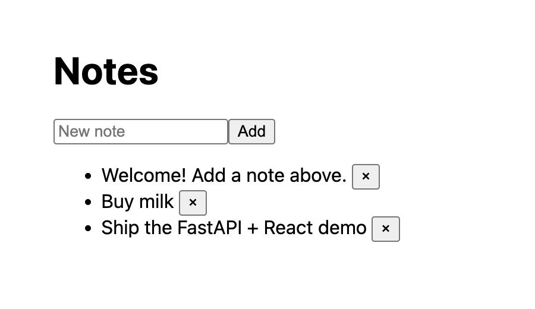

# fastapi-react

Minimal notes app: React (Vite) + FastAPI + SQLite.



```
backend/   FastAPI app (main.py), SQLite file created at backend/app.db
frontend/  React app; Vite proxies /api -> http://127.0.0.1:8000
```

## Run

Backend (terminal 1):

```sh
cd backend
uv venv && uv pip install -r requirements-dev.txt
.venv/bin/fastapi dev main.py                   # http://127.0.0.1:8000  (docs at /docs)
```

Frontend (terminal 2):

```sh
cd frontend
npm install
npm run dev                                     # http://localhost:5173
```

## Check

```sh
scripts/smoke.sh   # all checks below + live API round trip (if servers are running)
```

Individual checks (CI runs the same ones in `.github/workflows/ci.yml`):

| Area | Lint / format | Types | Tests / build |
|---|---|---|---|
| `backend/` | `.venv/bin/ruff check .` · `.venv/bin/ruff format --check .` | `.venv/bin/mypy .` (strict) | `.venv/bin/pytest -q` |
| `frontend/` | `npm run lint` (ESLint, type-aware) · `npm run format:check` (Prettier) | `npm run typecheck` (`tsc -b`, strict) | `npm run build` |

Config lives in `backend/pyproject.toml`, `frontend/eslint.config.js`, `frontend/tsconfig*.json` and `frontend/.prettierrc.json`. Auto-fix with `ruff check --fix . && ruff format .` and `npm run format`.

Agent workflow rules (testing, commits, PR screenshots) are in `CLAUDE.md`.
