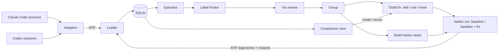

# Spec: Hindcast — from my sessions to a tested fix

Status: draft 4. Phase 0 (the Harbor trial) is done; its results are in 2.1. No application code is written yet.

**Name.** *Hindcast* is a forecasting term: you test a model against past data whose outcome you already know. Here, past agent sessions are rebuilt as tasks to check whether a fix would have changed what happened. The CLI is `hindcast`. The bare name is taken on PyPI and npm by an unrelated 0.0.1 package, so the package is published as `hindcast-ai`. The working name *Hindsight* was dropped because Vectorize's *Hindsight* is an agent-memory product with an MCP server (about 60k GitHub stars), which is the same thing section 11 defers.

Changes from draft 3:
- New name.
- Section 2.1 (trial results) written.
- The Claude Code and Codex adapters are our own parsers; Harbor's converters are used only as a test oracle.
- `--bare` replaced with `--safe-mode`, because `--bare` cannot use the subscription.
- Labels are per episode instead of per session, with a cause-only friction vocabulary and defined scores.
- The distilled output is typed: skill, rule or hook. The benchmark baseline includes your current instructions.
- Harbor task, job and auth details corrected against 0.25.0. The rubric judge moves to RewardKit, after a spike.
- New 6.6: the private benchmark repo.
- A demo script (section 9).
- JSON Schemas in the appendix.

## 1. What the first version does

1. **Import.** Read every Claude Code and Codex session on this machine into one SQLite database in one format.
2. **Label.** Find the episodes with friction and say what caused it, in a fixed vocabulary. You review the labels.
3. **Distill.** From a group of similar friction, draft a **fix**: a skill (`SKILL.md`), a rule (a `CLAUDE.md`/`AGENTS.md` paragraph) or a hook. You edit it.
4. **Benchmark.** Turn the friction episodes into Harbor tasks and run them with and without the fix, several times each, against your current instructions. Then show whether the fix helped.

**Value in one sentence:** find the corrections you keep repeating to your coding agents, turn them into a fix, and prove on reconstructions of those exact situations that the fix changes what the agent does.

Why the benchmark is the core and not an extra: SkillsBench found that curated skills raise pass rates by about 16 points, while skills an agent writes for itself give negligible or negative benefit. A drafted fix is worth installing only after it is measured. Claude Code's `/insights` and memory tools such as Beacon already propose fixes from history. None of them measure the fix on your own tasks.



Harbor's runs come back as ATIF and go through the same loader as imported sessions, so a benchmark run opens in the same session view as a real session.

## 2. Decisions

| Question | Decision | Why |
|---|---|---|
| Data format | **ATIF** as SQLite tables with ATIF's field names. Export writes `ATIF-v1.7`; the loader accepts v1.0–v1.8. | It covers user, agent and system steps, reasoning, tool calls and results, per-step tokens and cost, subagents and compaction. The RFC and Harbor's models are at v1.8, which only adds audio. Harbor's Claude Code and Codex agents still write v1.7. |
| Adapters | **Our own parsers** for Claude Code and Codex. Harbor provides the ATIF Pydantic models, `TrajectoryValidator`, and a token-total oracle for tests. | On real sessions Harbor's converters get message merging and token totals right and most other things wrong (3.1). |
| Relation to Session Hub | **Standalone** (owner's decision, 2026-11-11). | Session Hub (`~/Development/lynx-eval`) already imports sessions as ATIF and runs model A/B experiments on Harbor. Hindcast does not depend on it. The one exception: its archive of native Claude Code logs is an optional import source (3.1), because Claude Code deletes old sessions. |
| Benchmark runner | **Harbor 0.25.0**, called as a CLI (`harbor run -c job.yaml`) | It has `claude-code` and `codex` agents, `--skill`, repeats, local Docker, cost and token results, and ATIF output. Subscription auth is confirmed for Claude Code (2.1). Codex is not tried yet. |
| LLM for labeling, grouping, distilling | **Local `claude -p`** with `--json-schema` and `--safe-mode` (7) | Checked on CLI 2.1.322: the parsed answer comes back in `structured_output`. `--safe-mode` turns off your CLAUDE.md, skills, plugins, hooks and MCP servers but keeps subscription login. `--bare` is not usable, because it accepts only `ANTHROPIC_API_KEY`. |
| Rubric judge | **RewardKit inside Harbor's verifier**, if the phase-4 spike passes (6.4). Otherwise the host `claude -p` judge. | The rubric travels with the task, the judge cannot see the variant, and sampling, agreement and injection guards are built in. |
| Isolation | **Docker**, through Harbor | Harbor has no bare-host mode. Docker 29.7 is installed. |
| Harnesses | Claude Code and Codex for import. Claude Code only as the benchmark agent in the MVP. | Others later through the adapter interface. |
| Repo | Replace the notes app here. Benchmark content lives in a separate private repo (6.6). | Keep the project rules: FastAPI, stdlib `sqlite3`, `mypy --strict`, strict TypeScript, `scripts/smoke.sh`, ports 8000 and 5173. |

What is verified: the ATIF fields come from the RFC. The Harbor facts come from the installed 0.25.0 source (`~/Development/harbor` is a 0.24.0 checkout, and where they differ the installed code wins) and from the trial in 2.1. The session-format facts come from 923 real Claude Code files (Claude Code versions 2.1.274–2.1.322) and 195 real Codex rollouts (Codex 0.155–0.167). Anything the trial did not exercise is marked **unverified** where it appears.

### 2.1 Harbor trial run (phase 0)

On 2026-11-11 I installed Harbor 0.25.0 (`uv tool install harbor`) and ran one hand-made task in local Docker with the `claude-code` agent: Claude Code 2.1.322, `anthropic/claude-sonnet-5-5`, on the subscription token `CLAUDE_CODE_OAUTH_TOKEN`. There was one trial without a skill and one with a hand-written skill. They were two jobs started at the same time with command-line flags, not job YAML. The evidence is in `~/.hindcast/fixtures/phase0/`; native session dirs were left out because they hold `.claude.json`. It moves to the bench repo's `fixtures/phase0/` once that repo exists (6.6).

- **Task** (`harbor init -t trial/changelog-entry --no-solution`): add a 1.2.0 entry to `CHANGELOG.md` in a one-commit git repo at `/app`. `tests/test.sh` writes the diff to `/logs/verifier/diff.patch` and `{"has_entry": 0|1, "house_style": 0|1}` to `/logs/verifier/reward.json`.
- **Skill** (`--skill skills/changelog-house-style`): every changelog bullet ends with `[ticket: REL-<version without dots>]`.

| Run | `has_entry` | `house_style` | `Skill` tool called | Steps | Reported cost | Agent setup | Agent run | Trial total |
|---|---|---|---|---|---|---|---|---|
| Without skill | 1 | 0 | no | 4 | $0.022 | 3 min 33 s | 4 s | 4 min 02 s |
| With skill | 1 | 1 | yes | 5 | $0.032 | 2 min 55 s | 4 s | 3 min 25 s |

Confirmed:
- The subscription token works for `claude-code`. No API key is needed.
- `--skill <dir>` reaches the agent. The trajectory shows a `Skill` tool call, so whether the skill was invoked can be read from data. The skill text then appears as a step with `source: user` that starts "Base directory for this skill:". The importer tags it so it does not count as a user message (3.1).
- `reward.json` with several named metrics works. Each metric becomes its own entry in `verifier_result.rewards`.
- Per-trial output is `<jobs>/<job>/<task>__<id>/`, containing:
  - `result.json` (rewards, tokens, cost, per-phase start and end, `exception_info`)
  - `config.json` and `trial.log`
  - `agent/trajectory.json` (ATIF-v1.7)
  - `agent/claude-code.txt` (stream-json)
  - `agent/sessions/projects/-app/<uuid>.jsonl` (the native session)
  - `verifier/reward.json`, plus whatever `test.sh` writes to `/logs/verifier/`

Learned:
- **Setup dominates.** About 3 minutes per trial goes to installing Node and Claude Code in the container, against about 4 seconds of agent work. A base image with Claude Code preinstalled fixes this (6.1). The two jobs ran at the same time, so part of the 3 minutes may be contention.
- **"Cost" is an API-equivalent estimate.** Nothing is billed on a subscription. The two cost fields also disagree ($0.032 in `agent_result.cost_usd` vs $0.023 in `model_usage`). Use `agent_result.cost_usd` and label it as an estimate.
- **The host environment leaks in.** The agent ran with `--effort medium` although none was set, most likely from `CLAUDE_CODE_EFFORT_LEVEL` in my shell. Runs pin effort and start from an explicit environment (6.3).
- **Timestamps differ by level.** Job-level `result.json` timestamps are local time with no zone; trial-level ones are UTC. The loader normalizes them.
- **The diff came back through `/logs/verifier/`, not as a Harbor artifact.** `git diff HEAD` also misses new files (6.1).

Not tried: Codex as a benchmark agent, job YAML files, `-k` repeats, Harbor artifacts, RewardKit, and any statistics (one trial per variant).

## 3. Import

### 3.1 One path into the database

Each adapter turns a native session file into ATIF `Trajectory` objects: one per session and one per subagent. One loader writes ATIF into SQLite. Harbor's `agent/trajectory.json` is already ATIF and goes straight to the loader.

**Why our own parsers.** Harbor 0.25.0's private converters (`_convert_events_to_trajectory`) pass `TrajectoryValidator` on real sessions, but:

- **Claude Code:**
  - It flattens subagents into the parent, with no `subagent_trajectories` or refs, and skips workflow subagents. On one session it read 2 of 10 files and missed 40% of output tokens.
  - It drops compaction boundaries.
  - It turns task notifications and command output into user steps.
  - It dumps images as base64 JSON into the text.
  - It appends a `[metadata] {json}` dump to most tool results.
  - It keeps tool errors only in `observation.results[].extra.tool_result_is_error`, which is why draft 3 saw "no tool errors".
  - Given a directory, it merges every session in it into one trajectory.
- **Codex:**
  - It ignores `event_msg/item_completed`, so it reports no exit codes, edits or MCP errors. One sample with 8 failed commands showed none.
  - It drops failed turns.
  - It labels every step with the first turn's model; in one 3-turn session, 10 of 13 steps were mislabeled.
  - It turns injected AGENTS.md and environment messages into user steps.
- **What both get right:** message merging and token totals. These are exactly the parts the fixture tests compare (3.4).

Using our own parsers also removes the dependency on private Harbor functions.

**Claude Code** (`~/.claude/projects/<project-slug>/<sessionId>.jsonl`, with subagents in `<sessionId>/subagents/agent-<agentId>.jsonl` plus a sibling `.meta.json`, and workflow subagents in `<sessionId>/subagents/workflows/<runId>/agent-<agentId>.jsonl`). Records are dispatched on `type` only. A `message` field on any other type, such as `api-request-blob`, is ignored; reading it double-counts tool calls.

- **Agent responses.**
  - Each assistant line carries one content block. Lines that share `message.id` are one model call and become one agent step (`llm_call_count = 1`).
  - Usage comes from the **last** line of the `message.id`. The input and cache fields are equal on every line, but `output_tokens` grows while streaming, so summing every line overcounts about 2.2×.
  - A `message.id` that appears in two files (a fork subagent copies its parent's spawning call) is counted once and marked `extra.is_copied_context` in the copy.
- **Tool results.** A `user` record whose content is `tool_result` blocks does not become a step. Each block becomes an `observation.results[]` entry on the agent step that holds the matching `tool_use` (`source_call_id = tool_use_id`).
- **User steps are human prompts only.** That means `user` records with string or text content that are none of the following:
  - `isMeta` or `isCompactSummary`
  - `<task-notification>`, `<local-command-…>` or `<command-name>`
  - an interrupt marker
  - a skill injection ("Base directory for this skill:")

  Those become `system` steps, with `extra.claude_kind` set to `meta`, `task_notification`, `local_command`, `interrupt` or `skill_injection`. Claude Code ≥2.1.3xx marks human prompts with `turnPosition.promptIndex` and `turnOrigin: human`. Both are used when present.
- **Subagents.** Each subagent file is its own trajectory, with `parent_trajectory_id` and `parent_tool_call_id` set. The link to the parent tool call comes from one of:
  - `meta.json.toolUseId` or `toolUseResult.agentId` (Agent tool)
  - `toolUseResult.runId` = the workflow directory (Workflow tool: one call, many subagents)
  - a later `<task-notification>` (background agents, which return `async_launched` at once)
- **Compaction.** Each compaction is two records: a `system`/`compact_boundary` record, and an `isCompactSummary` user record timestamped 1–2 ms *earlier*. Together they form one `system` step:
  - `message` = "Context compaction"
  - `observation.results[0].content` = the summary
  - `extra.context_management = {type: "compaction", boundary: "replace"}`
  - `extra.compact = compactMetadata` (`trigger`, `preTokens`)
- **Errors and interrupts.**
  - Assistant records with `isApiErrorMessage` (model `<synthetic>`) and `system`/`api_error` records become `system` steps with `extra.claude_kind = "api_error"` and no metrics.
  - `[Request interrupted by user…]` sets `stop_reason = interrupted` on the agent step before it.
- **Other records.**
  - `attachment` subtypes `queued_command`, `hook_*`, `edited_text_file` and `structured_output` go in the `extra` of the next step.
  - `system`/`turn_duration` supplies turn durations.
  - The last `cost-state` record goes to `trajectories.extra.claude_cost_state`.
  - The other types are kept raw and produce no steps. On this machine there are 32 record types, plus 9 `system` subtypes and 39 `attachment` subtypes.
- **Reasoning.** 88% of thinking blocks have empty text and only a signature. `reasoning_content` is null for those.

**Codex** (`~/.codex/sessions/**/rollout-*.jsonl` and `~/.codex/archived_sessions/`; when both have the same file, the `sessions/` copy wins). One record per line: `{timestamp, ordinal, type, payload}`.

- **Identity and context.**
  - `session_meta` (the first line) gives `id` (= `session_id`), `cwd`, `cli_version` (= `agent_version`), `originator`, `source`, and `git = {commit_hash, branch}` when `cwd` is a repo.
  - `turn_context` (one per turn) gives `model`, `effort` (or `collaboration_mode.settings.reasoning_effort`), `cwd`, and the sandbox and approval policy.
  - The model can change between turns, so each agent step takes `model_name` and `reasoning_effort` from the latest `turn_context`.
- **Turns.**
  - A turn runs from `event_msg/task_started` to `task_complete` or `turn_aborted`, with the same `turn_id`. Every `response_item` carries its `turn_id` in `internal_chat_message_metadata_passthrough`.
  - A user step is only real user input: the `role=user` message matched by `event_msg/item_completed` `UserMessage` (`event_msg/user_message` in older versions).
  - Other `role=user` messages (`# AGENTS.md instructions`, `<environment_context>`) and `role=developer` messages become `system` steps.
- **Steps and tokens.**
  - One agent step per model call: the `response_item`s (`reasoning`, `message`, `custom_tool_call`, `function_call`, `local_shell_call`, `web_search_call`) that come before the call's `token_usage_record`.
  - Tokens come from that record's `usage`: `prompt_tokens = input_tokens` (already includes cached), `cached_tokens = cached_input_tokens`, `completion_tokens = output_tokens` (already includes reasoning). `reasoning_output_tokens` and `cache_write_input_tokens` go in `extra`.
  - Files with no `token_usage_record` use `event_msg/token_count.info.last_token_usage`, but only when `info.total_token_usage` changed from the previous `token_count`. Some events repeat the previous total.
  - Never sum `turn_token_usage`, `thread_token_usage` or `total_token_usage`; they are running totals.
  - Codex records no cost, so `cost_usd` is an estimate (3.2).
- **Tool calls.**
  - Each `*_output` is joined to its call by `call_id`. This held for 3,147 of 3,147 calls.
  - Since 0.155, the model mostly calls one tool, `exec` (2,988 of 3,026 calls). Its input is a script that runs several operations: `exec_command`, `apply_patch`, `write_stdin`, web and MCP.
  - Each operation is logged as `event_msg/item_completed` (`CommandExecution`, `FileChange`, `McpToolCall`, `Extension`) with **no `call_id`**. It is attached to the `exec` call whose time window (call `timestamp` to output `timestamp`) contains the operation's `started_at_ms`. This held for 3,177 of 3,177 operations.
  - Line order is not used, because 52 operations are logged after their call's output.
  - Operations go in `tool_calls.extra.ops`, with `type`, `command`, `parsed_cmd`, `exit_code`, `status`, `duration_ms` and the `changes` diff.
  - An output starting `Script running with cell ID N` continues in later `wait {cell_id: N}` calls, which get `extra.continues_cell`.
- **Errors.**
  - `is_error` is true when any of these holds:
    - the output starts `Script failed`
    - an attached operation has `status = failed`
    - an attached operation has a nonzero `exit_code`
    - an attached operation has `result.isError = true`
  - A turn-level `task_complete.error` (`{message, codex_error_info}`) is not a tool error. It sets `stop_reason = error` on the turn's last step, or on a system step if the turn has no agent step, and goes in `extra.turn_error`.
- **Reasoning** is encrypted. `reasoning_content` is the joined `summary[].text`, or null when the summary is empty, which is always the case on this machine (`turn_context.summary = "none"`). `extra.reasoning_encrypted = true`.
- **Compaction** (`compacted`, `response_item` `compaction`/`context_compaction`) becomes a system step with `extra.context_management = {type: "compaction"}`. **Unverified:** no local session has a compaction, so a fixture must be produced on purpose.
- **Forks and subagents.** A rollout with `session_meta.forked_from_id`, or a MultiAgent subagent rollout, starts by replaying its parent's history, and that replayed prefix is skipped. The prefix ends at the first `task_started`, or at `inter_agent_communication_metadata` with `trigger_turn: true`. Without the skip, the parent's steps and tokens count twice. **Unverified:** this comes from ccusage's adapter, and no local session has a fork or subagent.
- **Bookkeeping** (`world_state`, `thread_settings_applied`, `additional_tools`, `configuration_update`, `dynamic_tools_updated`, `security_risk_score`, `realtime_item`, and other `event_msg` types) is kept raw and produces no steps.

**Sources.** Claude Code deletes old sessions: `~/.claude/projects` holds 9 sessions today. On first run the importer also offers `~/.session-hub/archive/*.jsonl.gz` (893 native Claude Code files from Sep–Oct 2026), parsed by the same adapter. Without it, the first labeling pass has almost nothing to work on.

**Rules for ingestion:**

- **Incremental.** Ingestion is idempotent: a cursor per file, only appended bytes are read, and a re-scan changes nothing. The cursor also stores the file size and a hash of the first 4 KB. If the file shrinks or the hash changes (Codex can rewrite rollouts in place, for example in the `legacy_to_paginated_v1` migration), the file is re-ingested from the start. A later `session_meta` in the same file (a resume) appends turns to the same trajectory.
- **Raw records kept.** Every source line is kept unchanged in `raw_records`, so an adapter fix can re-derive sessions after the harness has deleted the files.
- **Unknown types are never dropped.** An unknown record type is stored raw and counted; it is never dropped and never fatal. The UI shows the count per harness.
- **Secrets are redacted before writing:** key patterns, bearer tokens and `.env` values.
- **Git state.** Codex records `commit_hash` and `branch` in `session_meta.git` at session start, with no dirty flag. Claude Code records `gitBranch` but no commit. When the watcher first sees a new session, it records `git rev-parse HEAD` and whether the tree is dirty. Where the Codex value and the watcher's value differ, the `session_meta` value wins and both are kept.
- **Own calls excluded.** The importer skips the project slug of `~/.hindcast/llm-cwd/` (7).

### 3.2 Schema

Column names follow ATIF wherever ATIF has the field. Columns marked **+** are additions. On export they go into the ATIF `extra` named in the last row of each table; `Step` and `ObservationResult` reject unknown keys anywhere else.

**`trajectories`**

| Column | Notes |
|---|---|
| `trajectory_id` | Primary key. Root: the harness session id. Subagent: `<session_id>:<agentId>`. |
| `session_id` | The harness's session id. Shared by a parent and its subagents. |
| `parent_trajectory_id`, `parent_tool_call_id` **+**, `subagent_kind` **+** | Set for subagents. `subagent_kind` is `agent`, `fork` or `workflow`. A Workflow call can have many subagents, so the link lives here and not on `tool_calls`. |
| `schema_version` | The version read; export writes `ATIF-v1.7` |
| `agent_name`, `agent_version`, `model_name` | `claude-code` or `codex`; the session's first model |
| `origin` **+** | `organic` or `benchmark` |
| `project_path`, `git_branch`, `git_commit`, `git_dirty` **+** | |
| `started_at`, `ended_at` **+** | UTC |
| `total_prompt_tokens`, `total_completion_tokens`, `total_cached_tokens`, `total_cost_usd`, `total_steps` | ATIF `final_metrics`, summed over this trajectory's own steps only; the UI sums the subagent tree. `total_cost_usd` is estimated from tokens with a pinned price table. |
| `extra` | JSON. Includes `cost_source = "estimate"` and, for Claude Code, `claude_cost_state`. Claude Code's own totals are expected to be higher, because they include calls missing from the transcript (compaction summaries, Haiku side calls). |
| → export | **+** columns go to the root `extra` |

**`steps`**

| Column | Notes |
|---|---|
| `trajectory_id`, `step_id` | `step_id` starts at 1 in each trajectory |
| `timestamp` | UTC |
| `source` | `system`, `user`, `agent` |
| `message` | Text, or a JSON array of ATIF content parts when there are images. Images arrive as inline base64; the bytes go to `blobs`, and the part is `{type: "image", source: {media_type, path: "images/<blob-sha>.<ext>"}}`. |
| `reasoning_content`, `model_name`, `reasoning_effort` | Agent steps only |
| `prompt_tokens`, `completion_tokens`, `cached_tokens`, `cost_usd` | ATIF `metrics`. `prompt_tokens` includes cached tokens. **Claude Code:** `prompt_tokens = input_tokens + cache_read_input_tokens + cache_creation_input_tokens` and `cached_tokens = cache_read_input_tokens`, taken from the last line of the `message.id`. **Codex:** taken directly from `usage` (3.1). `completion_tokens` includes reasoning tokens. `metrics.extra` keeps `cache_creation_input_tokens`, the 5-minute and 1-hour cache-creation split (they are priced differently) and `reasoning_tokens`. `cost_usd` is always an API-price estimate. |
| `llm_call_count` | 1 when the step is one model call; null when unknown |
| `stop_reason` **+** | `end_turn`, `tool_use`, `max_tokens`, `refusal`, `error`, `interrupted`. **Claude Code:** the last non-null `stop_reason` over the message's lines (`stop_sequence` maps to `end_turn`). If all lines are null (about 4% of messages), it is `tool_use` when the message has a `tool_use` block and `end_turn` otherwise. **Codex:** a step with tool calls → `tool_use`; a message with `phase = final_answer` → `end_turn`. **Both:** `interrupted` from an interrupt or `turn_aborted`; `error` from an API error or `task_complete.error`. The raw value is kept in `extra.raw_stop_reason`. |
| `turn_index` **+** | 0-based. A turn is a human prompt (3.1) and everything until the next one. Claude Code uses `turnPosition.promptIndex − 1` when present; Codex uses the ordinal of `turn_id`. Task notifications, tool results, compaction, injected context and skill injections never start a turn. Steps before the first prompt get 0. |
| `extra` | JSON |
| → export | **+** columns go to the step `extra` |

**`tool_calls`**: one row per call, with its result.

| Column | Notes |
|---|---|
| `trajectory_id`, `step_id`, `tool_call_id` | |
| `function_name`, `arguments` | `arguments` is a JSON object |
| `content` | The raw result, from `observation.results[].content` joined by `source_call_id`: text joined, with images as content parts. Claude Code's `toolUseResult` goes in `extra`, not in `content`. Results over 16 KB go to `blobs`, with a preview here. |
| `is_error`, `error_class` **+** | `is_error` comes from `tool_result.is_error` (Claude Code) or the rule in 3.1 (Codex). `error_class` is set by rules on the result text: `nonzero_exit` (`Exit code N`, or a Codex `exit_code`), `invalid_input` (`<tool_use_error>`), `hook_denied` (`PreToolUse:… hook error`), `user_rejected` ("The user doesn't want to proceed"), `interrupted`, `edit_mismatch` (Edit "string not found", Codex `apply_patch verification failed`), `timeout`, `not_found`, `permission_denied`, `other`. |
| `tool_kind` **+** | `shell`, `read`, `edit`, `search`, `web`, `mcp`, `subagent`, `skill`, `other`. **Claude Code:** by tool name. **Codex `exec`:** by its attached operations. All `FileChange` → `edit`; `parsed_cmd` read, search or list_files → `read` or `search`; `McpToolCall` → `mcp`; web search → `web`; anything else, or a mix, → `shell`. |
| `duration_ms` **+** | Claude Code: `toolUseResult.durationMs` (or `durationSeconds × 1000`), present on about 16% of results; otherwise the result timestamp minus the call timestamp. Codex: the operation durations. |
| `extra` | JSON: Codex `ops` and `continues_cell`; Claude Code `tool_use_result` |
| → export | `tool_kind` goes to `tool_calls[].extra`; `is_error`, `error_class` and `duration_ms` go to `observation.results[].extra`. The parent tool call of a subagent gets one `subagent_trajectory_ref` per subagent. |

Supporting tables: `raw_records`, `source_files` (the ingest cursor, prefix hash and parser version), `blobs`, and an FTS5 index over messages, reasoning, arguments and results.

### 3.3 UI

- **Sessions**: a list with filters (harness, project, model, date, has errors, has friction label) and sorting (cost, duration, friction score).
- **Session**: one timeline for both harnesses, with:
  - messages and collapsible reasoning
  - tool calls with arguments, result, error state and duration
  - tokens and cost per step
  - subagents nested
  - episodes (4.1) marked

### 3.4 Tests

- **Fixtures.** Small redacted fixture sessions per adapter, with expected ATIF. The Codex fixtures cover:
  - a 0.155+ `exec` session with a failed command and a `Script failed`
  - a mid-session model switch
  - a failed turn
  - a `wait`/`write_stdin` continuation
  - compaction, a fork and a subagent, which must be produced on purpose

  Real examples for the first four are under `~/.session-hub/**/agent/sessions/`. The Claude Code fixtures cover subagents (Agent, Workflow and background), compaction, images in tool results, an interrupt, an API error and a skill injection.
- **Token oracle.** For each fixture, our token totals equal Harbor's converter totals. For Claude Code this applies to the files Harbor reads, so it excludes workflow subagents.
- **Validator.** Every export passes `TrajectoryValidator`.

## 4. Label friction

### 4.1 The unit is an episode

Sessions are too big to label as a whole: the top friction sessions have 372 and 499 user messages. An **episode** is one turn (a human prompt and the agent's work until the next prompt) plus the next human prompt, which is the **reaction**. The reaction is the strongest friction signal. Tool errors are noisy: many failed calls are expected, as when tests fail during TDD or the agent probes.

### 4.2 Pass 1: rules, every episode, free

Each rule gives a signal. The episode's friction score is the weighted sum of the signals, and a session's score is its highest episode score. The components are stored as JSON, so the list can show why something ranks high.

| Signal | Definition | Weight |
|---|---|---|
| `correction` | The reaction matches correction patterns: negation plus instruction ("no, …", "don't", "I said", "why did you", "stop", "never", "again"), or quotes an earlier instruction | 3 |
| `reopened` | The agent's last message in the episode claims completion (done, fixed, works, all tests pass, verified), and the reaction is not acceptance | 3 |
| `rejections` | `user_rejected` calls, plus `interrupted` stop reasons | 2 each |
| `repeat_failures` | Runs of ≥3 errored calls with the same `function_name` and `error_class` within 10 steps | 2 each |
| `tool_errors` | Errored calls, capped at 10, excluding `hook_denied` and expected failures (a test command failing before an edit) | 0.3 each |
| `compactions` | Compaction steps | 1 each |
| `outlier_cost` | Episode cost or step count above your norm | 2 |

**Your norm** is the 90th percentile of that metric over your organic episodes with the same `agent_name` in the last 90 days. With fewer than 50 such episodes it uses fixed defaults: $2 or 80 steps per episode.

**Threshold for pass 2:** an episode score ≥ 4, or the top 20% of episodes, whichever selects fewer. You can also pick episodes by hand. The weights are a starting point; phase 2 measures whether the ranking holds your real friction (8).

### 4.3 Pass 2: `claude -p`, on episodes above the threshold

The input is a **condensed episode** (`condense(trajectory_id, turn_range, budget_chars) -> str`, versioned as `condenser_version`). Every line is prefixed with `[s<step_id>]` so the model can cite steps.

- **Context:** the session's first prompt and the two turns before the episode, each cut to 2,000 characters.
- **User messages:** in full, up to 4,000 characters. Longer ones keep the first 3,000 and the last 1,000, with `…[n chars cut]…` between.
- **Agent messages:** up to 1,000 characters. Reasoning is left out.
- **Tool calls:** one line each, for example `[s12] shell Bash "npm test" → ok` or `→ ERROR nonzero_exit: <first line>`. Arguments are cut to 200 characters.
- **Errored results:** the first 1,500 and the last 500 characters.
- **Subagents:** one line with their task, call count and error count, plus their errored calls.
- **Budget:** 200,000 characters.
- **Over budget:**
  1. Collapse runs of successful calls into one line, such as `[s40–s77] 38 calls (Read×20, Bash×18), 0 errors`.
  2. Cut agent messages to 300 characters.
  3. Cut middle steps.

  Each cut leaves a marker. A header states the harness, model, project, step count and whether anything was cut.

The output follows schema A1 in the appendix:

- `intent`: what you wanted, in one or two sentences.
- `task_type`: `feature`, `bugfix`, `refactor`, `setup_integration`, `debugging`, `research`, `review`, `ops`, `other`.
- `outcome`, with a reason:
  - `success`: it did what was asked, and you accepted it.
  - `partial`: it did some of it.
  - `failed`: the attempt ended without the result.
  - `abandoned`: you stopped it or changed the subject.
  - `unclear`: there is no evidence either way.
- `friction[]`, each with:
  - `type` and `severity` 1–3
  - `evidence_step_ids`
  - `user_corrected` (yes/no)
  - `instruction_quote` (for types 2–3)
  - `explanation`
  - `resolution_step_ids`: the steps where the problem was finally fixed. Distilling a fix needs these.

Each friction item has exactly one `type`: the **cause**, picked by the first row that applies. Whether you had to step in is recorded separately, as `user_corrected`.

| # | Type | Use when |
|---|---|---|
| 1 | `environment` | The cause is outside the agent's choices: a missing dependency, auth, a port in use, a sandbox or network limit, a rate limit |
| 2 | `instruction_ignored` | The agent broke an explicit instruction you can quote, from you or from CLAUDE.md/AGENTS.md, that was in context at the time |
| 3 | `context_loss` | Like 2, but the instruction or fact was given earlier and is now gone, usually after a compaction |
| 4 | `false_completion` | The agent said done, fixed or verified, and the evidence shows it was not |
| 5 | `requirement_missed` | The result lacks something you asked for, and the agent did not claim it was there |
| 6 | `wrong_assumption` | The agent acted on an unchecked belief about code, an API or state, and the belief was wrong |
| 7 | `overreach` | The agent did more than asked, built something more complex than needed, or did something destructive |
| 8 | `tool_misuse` | A tool call failed because of how the agent called it: bad arguments, an edit mismatch, a wrong path |
| 9 | `retry_loop` | ≥3 attempts at the same failing approach with no new information between them, and no row above applies. If one does, label the cause and mention the loop in `explanation`. |
| 10 | `inefficiency` | It worked, but took far more steps or tokens than needed, and no row above applies |

Code checks what the schema cannot express:
- Every cited `step_id` exists in the condensed input.
- `instruction_quote` is present for types 2 and 3.

Each label stores the model, prompt version, condenser version, input hash and cost from the wrapper (7). Its review state is one of `pending`, `confirmed`, `rejected` or `edited`. An `edited` label keeps the model's original JSON beside your version, so agreement can be measured.

**Review screen:** the label beside its evidence steps, keyboard confirm and reject, and multi-select. Two actions work on a selection: **Group** (5.1) and **Create benchmark dataset** (6).

## 5. Distill a fix

### 5.1 Group

The app proposes groups without embeddings:
1. Confirmed friction items are bucketed by `type`.
2. For each bucket with more than 3 items, one `claude -p` call gets up to 200 items (id, type, `explanation`, `intent`, `instruction_quote`, tools involved, error classes, project). It returns groups following schema A2: a name, the member ids, and a one-sentence statement of the shared lesson.
3. A group is offered only when it spans ≥3 sessions. Items left out stay ungrouped.

You can merge groups, split them, or group by hand. Groups are ranked by sessions × projects, so a theme that recurs across projects comes first.

### 5.2 Draft

`claude -p` gets the group's evidence. For each episode that is the intent, the friction items with their evidence steps, the reaction, and the steps listed in `resolution_step_ids`. It returns schema A3, which includes the **fix type**:

| Type | When | Artifact |
|---|---|---|
| `skill` | A procedure that applies to a recognizable kind of task, such as "integrating Stripe webhooks" or "releasing this package" | A directory `<name>/SKILL.md`, plus optional `references/*.md` |
| `rule` | A preference that applies everywhere or to one project, such as "keep it simple: no flags, canaries or backfills unless asked", or "verify end to end before saying done" | A paragraph for `CLAUDE.md`/`AGENTS.md`, global or for one project |
| `hook` | A hard guard that must never be crossed, such as "never launch a new browser" | A `PreToolUse` hook script with its settings snippet. Drafted and installable, but **not benchmarked in the MVP**. |

Most of the recurring friction in the real data is preference, so most fixes will be rules. A skill loads only when its description matches, so it may never fire for a preference that applies everywhere.

**SKILL.md format** (Agent Skills):
- Frontmatter `name`:
  - 1–64 characters: lowercase letters, digits and hyphens, with no leading or trailing hyphen.
  - The same as the directory name.
  - Must not contain "claude" or "anthropic".
- Frontmatter `description`:
  - 1–1,024 characters, no XML tags, third person.
  - Says what the skill does **and when to use it**, naming the triggers from the sessions: tools, libraries, error messages, task words.
  - This field decides whether the skill is invoked at all (6.5).
- Body: imperative instructions, under 500 lines. No secrets, no absolute paths from your machine, and no quotes from sessions that contain private data.

**Rule format:** at most 15 lines of Markdown, starting with a one-line summary.

Where a fix came from (sessions, group) is stored in the database, never in the fix itself, so the benchmark agent cannot see it.

### 5.3 Edit, version, export

- **Edit and version.** You edit the fix in the app.
  - Tables: `fixes` (id, type, name, created_at), `fix_versions` (fix_id, version, content JSON, author `model|user`, model, prompt version, created_at) and `fix_sources` (fix_version_id, trajectory_id, friction label id).
  - Saving validates the format rules above.
- **Export** writes the fix to the bench repo (6.6). Harbor's `--skill` takes a skill directory; a rule is applied as described in 6.3.
- **Install** is a separate button for real use, and I'd suggest pressing it only after the benchmark:
  - a skill goes to `~/.claude/skills/<name>/` or `~/.agents/skills/<name>/`
  - a rule is appended to the chosen `CLAUDE.md`/`AGENTS.md` as a reviewed diff
  - a hook is added to `settings.json` as a reviewed diff

## 6. Benchmark the fix on Harbor

### 6.1 An episode becomes a Harbor task

```
<dataset>/<task-name>/
  task.toml            [task] name = "hindcast/<task-name>"  (org/name is required)
                       [agent] timeout_sec; [verifier] timeout_sec; [environment] cpus, memory_mb
                       [metadata] source_trajectory_id, source_turn_range, kind, base_commit,
                                  repo_tar_sha256, rubric_version, hindcast_version
  instruction.md       the prompt
  environment/
    Dockerfile         FROM hindcast-base:<claude-code-version> + project setup
    CLAUDE.md          your current instructions for this project (the baseline, see 6.3)
    app/…              reconstructed tasks: the project source, committed
    repo.tar           replay tasks: generated, never committed (6.6)
  tests/
    test.sh            check command → /logs/verifier/reward.json; diff → /logs/verifier/diff.patch
    judge/rubric.toml  RewardKit rubric (6.4)
  solution/solve.sh    a reference solution, so `-a oracle` can prove the check is passable
```

- **`instruction.md`** is your first message in the episode, plus later messages that added requirements. `claude -p` drafts it and you edit it. Messages that only corrected the agent are left out, because the correction is what the task tests.
- **`environment/`.**
  - **Base image.** `hindcast-base:<v>` has Node and Claude Code `<v>` preinstalled. The job passes the same version as `agents[].kwargs.version`, so Harbor skips the 3-minute install (2.1).
  - **Replay tasks** copy in `git archive` of the repo at the base commit. Private repos stay on the machine, and nothing is cloned in the container.
  - **Dockerfile.** It is generated from what the repo uses (Python and uv, Node, …) and is editable.
  - **`CLAUDE.md`.** It is copied to `/app/CLAUDE.md` and committed in the image's repo before the agent starts, so it is not part of the diff. It holds your global instructions plus the project's own. It goes in the project and not in the user config, because Harbor sets `CLAUDE_CONFIG_DIR` to the trial's log directory.
- **`tests/test.sh`.**
  - It runs an optional check command (tests, build) and writes `{"check": 0|1}` to `/logs/verifier/reward.json`. The file holds numbers only, with one key per metric.
  - It then runs `git add -A && git diff --cached HEAD > /logs/verifier/diff.patch`, so new files are included.
  - The diff comes back at `<trial>/verifier/diff.patch`, as in 2.1. Harbor collects artifacts *before* the verifier runs, so a file that `test.sh` writes is not a Harbor artifact.
  - For preference themes it also writes measurable metrics where they apply: `diff_lines`, `new_files`, `new_config_keys`.
- **Rubric.** It is drafted from the intent and the friction as items such as "must do X", "must not do Y", "must follow instruction Z" (schema A4). It is stored in the database and exported to `tests/judge/rubric.toml`. You edit it. Items describe the result or the behavior, never the fix: "used the skill" is not an item.

**Task check, with no agent quota.** Before a task is used:
1. `harbor run -a nop` must score `check = 0`. This shows the task isn't already solved.
2. `-a oracle` must score `check = 1`. This shows the check can be passed.
3. `--install-only` with `claude-code` must succeed. This shows the image builds and the agent starts.

A task that fails any of these is marked broken and not counted.

### 6.2 Two kinds of task

Building a working container for an arbitrary private project at an old commit is the hardest part of the design. So there are two kinds:

| Kind | What it is | When to use |
|---|---|---|
| **Replay** | The real repo at the real commit, with the real prompt | The commit is known (Codex records it; Claude Code sessions imported after install have it from the watcher), and the project builds in a container |
| **Reconstructed** | A small standalone project, written by `claude -p`, that reproduces the same situation. Example: a fresh FastAPI app that needs Stripe webhooks. | The repo state is unknown or the project is too heavy. Also suits fixes about general procedure or preference, which is most of them. |

Reconstructed tasks have a known weakness: the same model writes the fix and the test. There are two guards:
- The task writer sees the session evidence but never the fix.
- Where a group spans enough sessions, the fix is distilled from some of them and tested on tasks built from the others.

**What a win means.** The instruction leaves out your correction, and the rubric encodes it. So a fix that states the preference wins the rubric by construction. The claim being tested is "the fix carries my preference into situations like these", not "the fix makes the agent better at everything". The check command and the unrelated tasks (6.3) are there to catch a fix that makes other work worse.

### 6.3 The run

**Variants.**
- **Baseline:** the agent, with your current instructions in `/app/CLAUDE.md`.
- **Candidate:** the baseline plus the fix.
  - A **skill** is added through `agents[].skills`, on the same dataset.
  - A **rule** is a generated sibling dataset, `<dataset>+<fix>@<version>`. It is identical except that the rule is appended to `environment/CLAUDE.md`. **Unverified** until the phase-4 spike.

There is one job config per variant, and they differ only in that. The same dataset (or its sibling), agent, model, effort and repeat count are used throughout.

```yaml
# candidate.yaml              (baseline.yaml omits `skills`)
job_name: keep-it-simple-v1-candidate
jobs_dir: <bench repo>/jobs/runs
datasets: [{ path: datasets/keep-it-simple }]
agents:
  - name: claude-code
    model_name: anthropic/<model>
    skills: [skills/keep-it-simple]
    kwargs: { version: "<claude-code version in hindcast-base>", reasoning_effort: medium, max_budget_usd: 2 }
n_attempts: 3
n_concurrent_trials: 2
environment: { type: docker }
```

- **YAML fields.** Every field above exists in Harbor 0.25.0's `JobConfig`. The YAML form itself is **unverified**: the trial used the equivalent command-line flags.
- **Separate jobs.** The variants must be separate jobs. Harbor groups job statistics by agent, model and dataset, so two `claude-code` entries in one job would be merged.
- **Concurrency.** Harbor's default is 4 concurrent trials, so the runner always sets `n_concurrent_trials`.
- **How it is launched.** The backend runs `env -i PATH=… HOME=… harbor run -c <file> --env-file <secrets> -y` as a background job and follows the job directory. With `env -i`, host variables such as `CLAUDE_CODE_EFFORT_LEVEL` cannot change the run (2.1). Tokens go in the env file, never in the YAML: `agents[].env` is written to `config.json`.
- **Auth uses your subscriptions.**
  - Claude Code uses `CLAUDE_CODE_OAUTH_TOKEN` from a one-time `claude setup-token`, plus `CLAUDE_FORCE_OAUTH=1`, so a stray `ANTHROPIC_API_KEY` cannot bill the API instead. This is confirmed in 2.1.
  - Codex (later) needs `CODEX_FORCE_AUTH_JSON=1` to make Harbor copy `~/.codex/auth.json`. Without it, Harbor uses `OPENAI_API_KEY` if set, and `.env` has one. Not tried.
- **Dataset.** The fix's own friction tasks, plus 1–2 unrelated tasks from a fixed `controls` dataset in the bench repo, to catch a fix that makes other work worse. `controls` starts with the phase-0 task and three small tasks written by hand.
- **Other comparisons.** The same mechanism compares models or harnesses: change `model_name` or `name` and keep the fix the same. That answers "a new model came out, is it better on my tasks?" with no extra design.

### 6.4 Grading

Each trial gets:
1. The **check** result and the measurable metrics, from `reward.json`.
2. A **rubric score**, by default from **RewardKit** inside Harbor's verifier:
   - The task builder writes `tests/judge/rubric.toml`: binary criteria, `samples = 3`, `guard = "flag"`.
   - `test.sh` ends with `uvx --from 'harbor-rewardkit==0.2.*' rewardkit /tests`, which adds `rubric` and one score per item to `reward.json`. Its inputs are `/logs/verifier/diff.patch` and the trajectory.
   - The judge uses `CLAUDE_CODE_OAUTH_TOKEN` through `[verifier.env]`, with `REWARDKIT_FORCE_SUBSCRIPTION=1`.
   - The judge never sees the job config, so it cannot know the variant.
   - After a rubric edit, existing trials are regraded with `harbor run --diff <job>`, which needs `[verifier] environment_mode = "separate"` and the diff declared as an artifact.

**Spike first (phase 4, step 1).** Run a one-criterion RewardKit judge on the phase-0 task with `-a oracle` and `-a nop`, which uses no agent quota. Confirm that:
- `/logs/agent/trajectory.json` is readable inside the verifier
- subscription auth works there
- regrade works
- a rule added to `/app/CLAUDE.md` is read by the agent

If the trajectory is not readable, the judge grades the diff only. If RewardKit fails, use the **host judge** instead. That is `run_structured` (7) with the instruction, the rubric, the diff and the condensed trajectory, following schema A5. Before the host judge sees the trajectory, the condenser removes:
- `Skill` tool calls
- reads of files under the skill directory
- skill-injection steps
- the system text that lists skills

Either way, the host judge is kept for the agreement sample.

**Rubric score:** the weighted share of applicable items that passed, with `not_applicable` items left out. It is computed in code, never by the judge. A failed `critical` item makes the trial a rubric fail, whatever the score.

**Agreement.** A sample of verdicts (5 per run, stratified by variant) is shown to you to confirm. The agreement rate is shown next to the results.

The judge is Claude. That is fine for comparing with and without a fix on one model. For Claude-versus-Codex comparisons it may favor its own style, so the check command is the main score there.

### 6.5 Results

For each trial the backend:
- loads `agent/trajectory.json` through the normal loader with `origin = benchmark`
- stores the rewards, rubric results, tokens, cost (`agent_result.cost_usd`, labeled as an estimate), duration and any `exception_info` from the trial's `result.json`
- records the bench repo commit and Harbor's `task_checksum`, so every number traces back to the exact task and fix

**Was the fix applied?**
- **Skill:** "invoked" means the trajectory has a `Skill` tool call with `arguments.skill == <name>`, or a skill-injection step naming it. This is Claude Code only. Codex has no Skill tool and reads skills as files.
- **Rule:** always present. "Followed" is measured by the rubric.

A skill that is never invoked shows no effect. The fix for that is its description (or turning it into a rule), not its content.

**Comparison view**

- **Per variant:**
  - pass rate (check), mean rubric score, and per-item pass rates
  - the measurable metrics (median `diff_lines`, new config)
  - cost, tokens, duration and tool errors
  - skill invoked n/N
- **Per item:** per-item rates are the most convincing view for preference fixes, for example "added a feature flag: 7/9 → 1/9".
- **Per task:** both variants side by side across repeats. Each cell links to that run's trajectory and diff.
- **Verdict:** a paired comparison over tasks, with 5,000 bootstrap resamples and a margin of 0.05. The view says **better**, **worse** or **no clear difference**. With fewer than 3 paired tasks it says "too few tasks for a verdict" and names no winner.
- **Next step:** **Install** on a win; **Revise** on no effect, which creates fix v2 and reruns only the candidate job. The comparison then shows v1 against v2.

### 6.6 Where benchmarks live

Datasets, fixes and job configs live in a separate **private** git repo, `hindcast-bench`, cloned at `~/.hindcast/bench`. Its content comes from private sessions, so it never goes in the app repo. The layout is the one Harbor reads:

```
hindcast-bench/
  registry.json              one entry per dataset@version, tasks by path
  datasets/<dataset>/<task>/ task directories (6.1); rule variants as <dataset>+<fix>@<v>/
  datasets/controls/         unrelated tasks (6.3)
  skills/<name>/SKILL.md     exported skills
  rules/<name>.md            exported rules
  hooks/<name>/              exported hooks
  jobs/configs/*.yaml        committed
  jobs/runs/                 ignored (Harbor output, imported into SQLite)
  base-images/claude-code/Dockerfile
  fixtures/phase0/           the 2.1 trial
  .gitignore                 jobs/runs/, **/repo.tar, **/agent/sessions/, .env*
```

- **Committed:** everything needed to rebuild a task, except private repo snapshots.
- **`repo.tar`:** regenerated by `hindcast bench materialize <task>` with `git archive` from `[metadata] base_commit`, then checked against `repo_tar_sha256`. A clone on another machine can run reconstructed tasks only, which is fine for a personal benchmark.
- **Versions:** a dataset version is a git tag (`keep-it-simple@v1`). The app commits each change it writes.
- **Secrets:** they are redacted (3.1) before anything is written, and a pre-commit secret scan (gitleaks) runs in the repo. Nothing is published to Harbor Hub.

## 7. Technical shape

- **Backend modules:**
  - `adapters/` (Claude Code, Codex)
  - `atif/` (models, loader, export)
  - `store/` (schema, migrations, queries)
  - `episodes/`, `labeling/`, `fixes/`
  - `bench/` (task builder, bench repo, Harbor job runner, judge, statistics)
  - `llm/` (the `claude -p` wrapper)
  - `api/`
- **Harbor** is installed as a tool (`uv tool install harbor==0.25.0`, needs Python 3.12+) and called by subprocess. The backend imports only Harbor's ATIF models and validator.
- **The `claude -p` wrapper.** It is one typed function, `run_structured(prompt: str, model: type[T], *, llm_model: str, timeout_s: int = 900) -> Result[T]`. `T` is a Pydantic model, and the schema passed to `--json-schema` is `T.model_json_schema()`.
  - The command is `claude -p --safe-mode --strict-mcp-config --disable-slash-commands --tools "" --no-session-persistence --output-format json --model <llm_model> --json-schema <schema>`.
  - The prompt goes on stdin, because argv is too small for a trajectory, and `cwd` is `~/.hindcast/llm-cwd/`.
  - `--safe-mode` keeps your hooks, skills, plugins, MCP servers and `CLAUDE.md` out of labeling and judging, while keeping subscription login. Do not use `--bare`: it requires `ANTHROPIC_API_KEY` and fails with "Not logged in" on a subscription.
  - `--no-session-persistence` writes no transcript, so the importer never sees the tool's own calls. As a second guard, the importer skips the `llm-cwd` project slug.
  - The answer is `structured_output` from the JSON result. Structured output costs one extra turn. A call fails when:
    - the exit code is non-zero
    - `is_error` is true
    - `structured_output` is missing or fails Pydantic validation

    It is retried once on timeout or failure; after that the job fails with the last `result` text.
  - Each call stores the model actually used (the key of `modelUsage`), prompt version, schema version, input SHA-256, `duration_ms`, token usage and `total_cost_usd`. On a subscription that cost is the API list-price equivalent, and the UI says so.
  - Models: `sonnet` for labeling, `opus` for grouping, distilling, task writing and the host judge. All are configurable.
- **Database:** one file, `~/.hindcast/hindcast.db`, in WAL mode, with numbered SQL migrations.
- **Background work** (scan, label, group, distill, task building, runs, judging) goes through a `jobs` table and one worker thread. Progress is visible in the UI.
- **Tests:** adapter fixtures with the token oracle and the validator (3.4); schema and code checks for every `claude -p` output; and API tests per endpoint.

## 8. Phases

| Phase | Scope | Done when |
|---|---|---|
| **0. Harbor trial** | **Done**, see 2.1. Claude Code only. | Passed: both runs finished in Docker; the skill changed `house_style` from 0 to 1; `trajectory.json`, `result.json` and `reward.json` are where 6.5 reads them. Not covered: job YAML, repeats, artifacts, Codex, RewardKit. |
| **1. Import** | Schema, both adapters, loader, archive import, incremental scan with prefix check, redaction, git capture, session list and session view, ATIF export | Every Claude Code and Codex session on this machine and in the archive loads with no parse failures. Every export passes Harbor's validator. On the fixtures, token totals equal Harbor's converter totals; on five sampled live sessions they equal the sum of last-line usage per `message.id` over the session and all its subagent files, and are at or below Claude Code's `cost-state` for the same models. The 3.4 fixtures pass. A re-scan changes nothing. |
| **2. Label** | Episodes, rule pass, `claude -p` pass, review screen | You label 40 episodes before seeing the model's labels: 20 above the threshold and 20 below, picked at random. Targets: outcome agreement ≥75% with Cohen's κ ≥0.6; per-episode friction-type recall and precision ≥70%; 100% of cited `step_id`s exist; the rule pass puts ≥15 of your friction episodes in its top 20. Disagreements are listed. |
| **3. Distill** | Grouping, typed fix drafts, editor, export, install | The top 3 groups are themes you recognize. A fix drafted from one of them is one you'd keep after editing. |
| **4. Benchmark** | Spike (6.4), base image, bench repo, reconstructed task builder with nop/oracle/install checks, Harbor runner, judge, result import, comparison view. Replay tasks follow. | The demo in section 9 runs end to end on real data. Every number opens the run behind it. |

Phase 4 starts with reconstructed tasks, because they don't depend on recovering old repo state. Replay tasks follow for sessions with a recorded commit: Codex sessions, and Claude Code sessions imported after phase 1 is installed.

## 9. Demo (the target for phase 4)

The theme is **"keep it simple"**. The real data has 92 corrections such as "no over-engineering", "no need for a flag" and "no backfill, simplest solution", across 49 sessions in 18 projects. It is the most benchmarkable theme: it fits in a container, and diff size, new flags and new config are measurable. Slow work runs beforehand; live, the demo shows one LLM step and pre-run results.

| Time | Screen | Live or prepared |
|---|---|---|
| 0:00–0:25 | Home: sessions, harnesses and weeks covered | prepared |
| 0:25–1:15 | **Friction groups**, ranked by sessions × projects. Open "keep it simple" to see 5 quoted corrections, each with the agent step before it (the canary, the flag, the backfill). | prepared |
| 1:15–2:05 | **Draft fix.** `claude -p` proposes a *rule* with links to its evidence episodes (about 45 s). Edit one line. | live |
| 2:05–2:35 | **Tasks:** 3 reconstructed tasks plus 1 control, each with instruction, rubric ("no feature flag", "no new config", "tests pass") and a passed nop/oracle check. The instruction does not contain the correction. | prepared |
| 2:35–2:50 | **Run** dialog: 2 variants × 4 tasks × 3 repeats = 24 trials, about 25 min, about $5–8 at list price. Start it, then switch to this morning's run. | live start |
| 2:50–4:20 | **Comparison:** check pass rate, rubric score, per-item rates ("added a feature flag 7/9 → 1/9"), median diff size, cost, and the verdict. Open a baseline cell (the trajectory adds `ENABLE_X`), then the matching candidate cell (a 12-line diff). | prepared |
| 4:20–5:00 | **Install:** the rule is appended to `~/.claude/CLAUDE.md` as a reviewed diff | live |

**Preparation:** episode labeling on 60–100 candidates (10–20 min), building and checking 4 tasks (15–30 min), 24 trials (about 25 min, about 10 min with the base image), and judging. In total about 1–1.5 hours wall-clock and $10–20 list-price equivalent on Sonnet.

## 10. Risks

- **Format drift.** Claude Code writes 32 record types on this machine, and both formats change without notice: Codex moved to one `exec` tool in 0.155. Raw records are kept, adapters are versioned, unknown records are counted, and the fixtures guard upgrades.
- **Unverified Codex paths:** compaction, forks and subagents (3.1). The fixtures have to be produced on purpose.
- **Trial setup time.** About 3 minutes per trial until the base image exists (2.1).
- **Containerizing real projects.** Many replay tasks will need a hand-edited Dockerfile. Reconstructed tasks avoid this, with the weakness in 6.2.
- **Tautology.** A fix that states the rubric's preference wins by construction (6.2). The controls and the check command are the guard against regressions.
- **Small numbers.** A handful of tasks with three repeats can show a large effect but not a small one. The view says so and doesn't name a winner on noise.
- **The judge is Claude** (6.4).
- **Subscription limits.** Tasks × variants × repeats uses your quota. The app shows the trial count and estimated cost before a run starts, sets `n_concurrent_trials` (Harbor defaults to 4) and a per-trial `max_budget_usd`.
- **Replay safety.** A session that deployed, sent messages or touched production must not do it again from a container. Tasks built from sessions with such tool calls are flagged and held until you review them. Containers get no credentials except the agent's own login.
- **Data volume.** The live harness logs hold few sessions (Claude Code deletes old ones). The archive import (3.1) and the watcher from phase 1 onward are what keep the history.

## 11. Deferred

- **Memory across harnesses.** Search over the same database, exposed to harnesses by an MCP server and a CLI, plus distilled preferences and procedures. The schema needs no changes; it adds an embeddings table. A benchmarked fix is already the first form of this: something learned from your sessions and installed into both harnesses.
- **Local proxy and routing.** It logs API traffic, then routes by rules, then by benchmark results per `task_type`. The model comparison in 6.3 produces the data it would route on.
- **Benchmarking hooks** and Codex as a benchmark agent.
- **More harnesses** (Pi, OpenCode, Cursor) through the adapter interface.

## 12. Settled

1. Harbor trial first: done (2.1).
2. Task order: reconstructed tasks first, replay tasks second.
3. Benchmark agent for the MVP: Claude Code only.
4. Name: Hindcast (2026-11-11).
5. Standalone, not built on Session Hub (2026-11-11). Session Hub's archive is an optional import source only.
6. The distilled output is typed (skill, rule, hook), and the baseline includes your current instructions (2026-11-11).
7. Rubric judge: RewardKit if the phase-4 spike passes, the host judge otherwise (GitHub issue #3).
8. Benchmark content lives in a separate private git repo (6.6, GitHub issue #4).

No open questions block phase 1.

## Appendix: JSON Schemas

These are the reference forms. Code generates them from Pydantic models, and every object has `additionalProperties: false`.

**A1. Label (`label.v1`)**

```json
{
  "type": "object", "additionalProperties": false,
  "required": ["intent", "task_type", "outcome", "outcome_reason", "friction"],
  "properties": {
    "intent": {"type": "string", "minLength": 1, "maxLength": 400},
    "task_type": {"enum": ["feature", "bugfix", "refactor", "setup_integration", "debugging", "research", "review", "ops", "other"]},
    "outcome": {"enum": ["success", "partial", "failed", "abandoned", "unclear"]},
    "outcome_reason": {"type": "string", "minLength": 1, "maxLength": 300},
    "outcome_evidence_step_ids": {"type": "array", "items": {"type": "integer", "minimum": 1}, "maxItems": 5},
    "friction": {"type": "array", "maxItems": 10, "items": {
      "type": "object", "additionalProperties": false,
      "required": ["type", "severity", "evidence_step_ids", "user_corrected", "explanation"],
      "properties": {
        "type": {"enum": ["environment", "instruction_ignored", "context_loss", "false_completion", "requirement_missed", "wrong_assumption", "overreach", "tool_misuse", "retry_loop", "inefficiency"]},
        "severity": {"enum": [1, 2, 3], "description": "1 = minutes lost; 2 = a turn or more lost, or the user had to step in; 3 = wrong or harmful result, or the task failed"},
        "evidence_step_ids": {"type": "array", "items": {"type": "integer", "minimum": 1}, "minItems": 1, "maxItems": 8},
        "user_corrected": {"type": "boolean"},
        "instruction_quote": {"type": "string", "maxLength": 300},
        "explanation": {"type": "string", "minLength": 1, "maxLength": 400},
        "resolution_step_ids": {"type": "array", "items": {"type": "integer", "minimum": 1}, "maxItems": 5}
      }}}
  }
}
```

**A2. Groups (`groups.v1`)**

```json
{
  "type": "object", "additionalProperties": false, "required": ["groups"],
  "properties": {"groups": {"type": "array", "maxItems": 30, "items": {
    "type": "object", "additionalProperties": false, "required": ["name", "lesson", "friction_ids"],
    "properties": {
      "name": {"type": "string", "pattern": "^[a-z0-9]+(-[a-z0-9]+)*$", "maxLength": 64},
      "lesson": {"type": "string", "minLength": 1, "maxLength": 300},
      "friction_ids": {"type": "array", "items": {"type": "integer"}, "minItems": 2}
    }}}}
}
```

**A3. Fix draft (`fix_draft.v1`)**

```json
{
  "type": "object", "additionalProperties": false,
  "required": ["fix_type", "name", "summary", "rationale"],
  "properties": {
    "fix_type": {"enum": ["skill", "rule", "hook"]},
    "fix_type_reason": {"type": "string", "maxLength": 300},
    "name": {"type": "string", "pattern": "^[a-z0-9]+(-[a-z0-9]+)*$", "maxLength": 64},
    "summary": {"type": "string", "minLength": 1, "maxLength": 200},
    "skill": {"type": "object", "additionalProperties": false, "required": ["description", "body"],
      "properties": {
        "description": {"type": "string", "minLength": 1, "maxLength": 1024},
        "body": {"type": "string", "minLength": 1, "maxLength": 40000},
        "files": {"type": "array", "maxItems": 5, "items": {"type": "object", "additionalProperties": false,
          "required": ["path", "content"], "properties": {
            "path": {"type": "string", "pattern": "^references/[a-z0-9-]+\\.md$"},
            "content": {"type": "string", "maxLength": 40000}}}}}},
    "rule": {"type": "object", "additionalProperties": false, "required": ["scope", "text"],
      "properties": {
        "scope": {"enum": ["global", "project"]},
        "project_path": {"type": "string"},
        "text": {"type": "string", "minLength": 1, "maxLength": 2000}}},
    "hook": {"type": "object", "additionalProperties": false, "required": ["event", "matcher", "script"],
      "properties": {
        "event": {"enum": ["PreToolUse", "PostToolUse", "UserPromptSubmit", "Stop"]},
        "matcher": {"type": "string", "maxLength": 200},
        "script": {"type": "string", "maxLength": 8000}}},
    "rationale": {"type": "array", "minItems": 1, "items": {"type": "object", "additionalProperties": false,
      "required": ["instruction", "friction_ids"], "properties": {
        "instruction": {"type": "string", "maxLength": 200},
        "friction_ids": {"type": "array", "items": {"type": "integer"}, "minItems": 1}}}},
    "open_questions": {"type": "array", "items": {"type": "string", "maxLength": 200}, "maxItems": 5}
  }
}
```

Code checks:
- Exactly one of `skill`, `rule` or `hook` is present, and it matches `fix_type`.
- The skill `name` does not contain `claude` or `anthropic`.
- The `description` has no XML tags.
- The skill body is under 500 lines.
- A rule is at most 15 lines.

`rationale` is shown in the editor beside each instruction and is never exported.

**A4. Rubric (`rubric.v1`)**

```json
{
  "type": "object", "additionalProperties": false, "required": ["version", "items"],
  "properties": {
    "version": {"const": 1},
    "items": {"type": "array", "minItems": 1, "maxItems": 12, "items": {
      "type": "object", "additionalProperties": false,
      "required": ["id", "kind", "text", "weight", "critical", "check_by"],
      "properties": {
        "id": {"type": "string", "pattern": "^r[0-9]+$"},
        "kind": {"enum": ["must", "must_not", "follow_instruction"]},
        "text": {"type": "string", "minLength": 1, "maxLength": 300},
        "weight": {"type": "integer", "minimum": 1, "maximum": 3},
        "critical": {"type": "boolean"},
        "check_by": {"enum": ["diff", "trajectory", "either"]},
        "source_friction_id": {"type": ["integer", "null"]}
      }}}
  }
}
```

**A5. Verdict, host judge (`verdict.v1`)**

```json
{
  "type": "object", "additionalProperties": false, "required": ["items", "summary"],
  "properties": {
    "items": {"type": "array", "items": {
      "type": "object", "additionalProperties": false, "required": ["id", "verdict", "evidence"],
      "properties": {
        "id": {"type": "string", "pattern": "^r[0-9]+$"},
        "verdict": {"enum": ["pass", "fail", "not_applicable"]},
        "evidence": {"type": "string", "minLength": 1, "maxLength": 400},
        "evidence_step_ids": {"type": "array", "items": {"type": "integer", "minimum": 1}, "maxItems": 5},
        "evidence_files": {"type": "array", "items": {"type": "string"}, "maxItems": 5}
      }}},
    "summary": {"type": "string", "maxLength": 400}
  }
}
```

Code checks: exactly one verdict per rubric `id`, and no extra ids. The score is computed in code (6.4).
