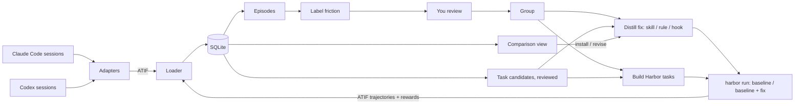

# Spec: Hindcast — from my sessions to a tested fix

Status: draft 6. Phase 0 (the Harbor trial) is done; its results are in 2.1. The verification runs, which replace the phase-4 spike, are in 2.2. No application code is written yet.

Changes from draft 5 (real runs; results in 2.2):
- **Codex (3.1):** compaction, resume, forks and subagents are rewritten from sessions produced on purpose. Draft 5's skip rules for a copied prefix were wrong, and forks copy nothing. Fixtures are in `~/.hindcast/fixtures/codex/`.
- **Judge (6.4):** RewardKit uses the `claude-code` agent judge, because the LLM judge gets a 429 on a subscription token. The judge reads its inputs from a staged workspace, `/tmp/judge`.
- **Verifier (6.1):** the separate verifier gets the diff from a `[[verifier.collect]]` hook and rebuilds `/app` with `git apply`. `harbor run --diff` regrades on a minor version bump.
- **Confirmed:**
  - the job YAML, repeats and the `env -i` launch
  - the nop, oracle and install-only checks
  - a rule in `/app/CLAUDE.md`
  - the base image, with agent setup at 0.1 s instead of 127 s

Changes from draft 4 (research on GitHub issues #3, #4 and #6; sources in Appendix B):
- New 4.4: a long session is split into reviewed **task candidates** with evidence and dependencies before anything is distilled or benchmarked (#6). New schema A6.
- 6.1 and 6.4 rewritten against RewardKit 0.2.4 and Harbor 0.25.0 (#3). The check, the metrics and the judge are all RewardKit dimensions, because RewardKit overwrites `reward.json`. The verifier runs in separate mode. Regrading is `harbor job regrade`.
- 6.6: a `dataset.toml` manifest per dataset with task digests, a task version scheme, canary strings, and a secret scan that a pre-commit hook alone cannot enforce (#4).

Changes from draft 3 to draft 4, kept for reference:

**Name.** *Hindcast* is a forecasting term: you test a model against past data whose outcome you already know. Here, past agent sessions are rebuilt as tasks to check whether a fix would have changed what happened. The CLI is `hindcast`. The bare name is taken on PyPI and npm by an unrelated 0.0.1 package, so the package is published as `hindcast-ai`. The working name *Hindsight* was dropped because Vectorize's *Hindsight* is an agent-memory product with an MCP server (about 60k GitHub stars), which is the same thing section 11 defers.

Changes from draft 3:
- New name.
- Section 2.1 (trial results) written.
- The Claude Code and Codex adapters are our own parsers; Harbor's converters are used only as a test oracle.
- `--bare` replaced with `--safe-mode`, because `--bare` cannot use the subscription.
- Labels are per episode instead of per session, with a cause-only friction vocabulary and defined scores.
- The distilled output is typed: skill, rule or hook. The benchmark baseline includes your current instructions.
- Harbor task, job and auth details corrected against 0.25.0. The rubric judge moves to RewardKit, after a spike.
- New 6.6: the private benchmark repo.
- A demo script (section 9).
- JSON Schemas in the appendix.

## 1. What the first version does

1. **Import.** Read every Claude Code and Codex session on this machine into one SQLite database in one format.
2. **Label.** Find the episodes with friction and say what caused it, in a fixed vocabulary. You review the labels.
3. **Distill.** From a group of similar friction, draft a **fix**: a skill (`SKILL.md`), a rule (a `CLAUDE.md`/`AGENTS.md` paragraph) or a hook. You edit it.
4. **Benchmark.** Turn the friction episodes into Harbor tasks and run them with and without the fix, several times each, against your current instructions. Then show whether the fix helped.

**Value in one sentence:** find the corrections you keep repeating to your coding agents, turn them into a fix, and prove on reconstructions of those exact situations that the fix changes what the agent does.

Why the benchmark is the core and not an extra: SkillsBench found that curated skills raise pass rates by about 16 points, while skills an agent writes for itself give negligible or negative benefit. A drafted fix is worth installing only after it is measured. Claude Code's `/insights` and memory tools such as Beacon already propose fixes from history. None of them measure the fix on your own tasks.



Harbor's runs come back as ATIF and go through the same loader as imported sessions, so a benchmark run opens in the same session view as a real session.

## 2. Decisions

| Question | Decision | Why |
|---|---|---|
| Data format | **ATIF** as SQLite tables with ATIF's field names. Export writes `ATIF-v1.7`; the loader accepts v1.0–v1.8. | It covers user, agent and system steps, reasoning, tool calls and results, per-step tokens and cost, subagents and compaction. The RFC and Harbor's models are at v1.8, which only adds audio. Harbor's Claude Code and Codex agents still write v1.7. |
| Adapters | **Our own parsers** for Claude Code and Codex. Harbor provides the ATIF Pydantic models, `TrajectoryValidator`, and a token-total oracle for tests. | On real sessions Harbor's converters get message merging and token totals right and most other things wrong (3.1). |
| Relation to Session Hub | **Standalone** (owner's decision, 2026-11-11). | Session Hub (`~/Development/lynx-eval`) already imports sessions as ATIF and runs model A/B experiments on Harbor. Hindcast does not depend on it. The one exception: its archive of native Claude Code logs is an optional import source (3.1), because Claude Code deletes old sessions. |
| Benchmark runner | **Harbor 0.25.0**, called as a CLI (`harbor run -c job.yaml`) | It has `claude-code` and `codex` agents, `--skill`, repeats, local Docker, cost and token results, and ATIF output. Subscription auth is confirmed for Claude Code (2.1). Codex is not tried yet. |
| LLM for labeling, grouping, distilling | **Local `claude -p`** with `--json-schema` and `--safe-mode` (7) | Checked on CLI 2.1.322: the parsed answer comes back in `structured_output`. `--safe-mode` turns off your CLAUDE.md, skills, plugins, hooks and MCP servers but keeps subscription login. `--bare` is not usable, because it accepts only `ANTHROPIC_API_KEY`. |
| Rubric judge | **RewardKit's agent judge (`claude-code`) inside Harbor's verifier** (6.4). It was checked in the spike (2.2). | The rubric travels with the task, the judge cannot see the variant, and sampling, agreement and injection guards are built in. RewardKit's LLM judge cannot use a subscription token. |
| Isolation | **Docker**, through Harbor | Harbor has no bare-host mode. Docker 29.7 is installed. |
| Harnesses | Claude Code and Codex for import. Claude Code only as the benchmark agent in the MVP. | Others later through the adapter interface. |
| Repo | Replace the notes app here. Benchmark content lives in a separate private repo (6.6). | Keep the project rules: FastAPI, stdlib `sqlite3`, `mypy --strict`, strict TypeScript, `scripts/smoke.sh`, ports 8000 and 5173. |

What is verified: the ATIF fields come from the RFC. The Harbor facts come from the installed 0.25.0 source (`~/Development/harbor` is a 0.24.0 checkout, and where they differ the installed code wins) and from the trial in 2.1. The session-format facts come from 923 real Claude Code files (Claude Code versions 2.1.274–2.1.322) and 195 real Codex rollouts (Codex 0.155–0.167). Anything the trial did not exercise is marked **unverified** where it appears.

### 2.1 Harbor trial run (phase 0)

On 2026-11-11 I installed Harbor 0.25.0 (`uv tool install harbor`) and ran one hand-made task in local Docker with the `claude-code` agent: Claude Code 2.1.322, `anthropic/claude-sonnet-5-5`, on the subscription token `CLAUDE_CODE_OAUTH_TOKEN`. There was one trial without a skill and one with a hand-written skill. They were two jobs started at the same time with command-line flags, not job YAML. The evidence is in `~/.hindcast/fixtures/phase0/`; native session dirs were left out because they hold `.claude.json`. It moves to the bench repo's `fixtures/phase0/` once that repo exists (6.6).

- **Task** (`harbor init -t trial/changelog-entry --no-solution`): add a 1.2.0 entry to `CHANGELOG.md` in a one-commit git repo at `/app`. `tests/test.sh` writes the diff to `/logs/verifier/diff.patch` and `{"has_entry": 0|1, "house_style": 0|1}` to `/logs/verifier/reward.json`.
- **Skill** (`--skill skills/changelog-house-style`): every changelog bullet ends with `[ticket: REL-<version without dots>]`.

| Run | `has_entry` | `house_style` | `Skill` tool called | Steps | Reported cost | Agent setup | Agent run | Trial total |
|---|---|---|---|---|---|---|---|---|
| Without skill | 1 | 0 | no | 4 | $0.022 | 3 min 33 s | 4 s | 4 min 02 s |
| With skill | 1 | 1 | yes | 5 | $0.032 | 2 min 55 s | 4 s | 3 min 25 s |

Confirmed:
- The subscription token works for `claude-code`. No API key is needed.
- `--skill <dir>` reaches the agent. The trajectory shows a `Skill` tool call, so whether the skill was invoked can be read from data. The skill text then appears as a step with `source: user` that starts "Base directory for this skill:". The importer tags it so it does not count as a user message (3.1).
- `reward.json` with several named metrics works. Each metric becomes its own entry in `verifier_result.rewards`.
- Per-trial output is `<jobs>/<job>/<task>__<id>/`, containing:
  - `result.json` (rewards, tokens, cost, per-phase start and end, `exception_info`)
  - `config.json` and `trial.log`
  - `agent/trajectory.json` (ATIF-v1.7)
  - `agent/claude-code.txt` (stream-json)
  - `agent/sessions/projects/-app/<uuid>.jsonl` (the native session)
  - `verifier/reward.json`, plus whatever `test.sh` writes to `/logs/verifier/`

Learned:
- **Setup dominates.** About 3 minutes per trial goes to installing Node and Claude Code in the container, against about 4 seconds of agent work. A base image with Claude Code preinstalled fixes this (6.1). The two jobs ran at the same time, so part of the 3 minutes may be contention.
- **"Cost" is an API-equivalent estimate.** Nothing is billed on a subscription. The two cost fields also disagree ($0.032 in `agent_result.cost_usd` vs $0.023 in `model_usage`). Use `agent_result.cost_usd` and label it as an estimate.
- **The host environment leaks in.** The agent ran with `--effort medium` although none was set, most likely from `CLAUDE_CODE_EFFORT_LEVEL` in my shell. Runs pin effort and start from an explicit environment (6.3).
- **Timestamps differ by level.** Job-level `result.json` timestamps are local time with no zone; trial-level ones are UTC. The loader normalizes them.
- **The diff came back through `/logs/verifier/`, not as a Harbor artifact.** `git diff HEAD` also misses new files (6.1).

Not tried in phase 0: Codex as a benchmark agent, and any statistics (one trial per variant). The spike in 2.2 covers job YAML, repeats, artifacts and RewardKit.

### 2.2 Verification runs (2026-11-11)

Two follow-up runs checked the claims that draft 4 had marked unverified.

**Harbor spike** (Harbor 0.25.0, harbor-rewardkit 0.2.4, Claude Code 2.1.322, agent and judge `claude-haiku-5-5`). It used 5 agent trials and about 12 judge runs, and is kept in `~/.hindcast/fixtures/spike-bench/`.

| Claim | Result |
|---|---|
| Job YAML (6.3) runs with `harbor run -c`; `n_attempts` gives N trials; dataset names with `+` and `@` work | Confirmed |
| `env -i` launch stops host variables leaking in | Confirmed. With `CLAUDE_CODE_EFFORT_LEVEL=high` exported, the run had no `--effort`; `reasoning_effort: medium` gave `--effort medium`. |
| `-a nop` scores 0, `-a oracle` scores 1, `--install-only` works | Confirmed, about 35 s each. Nop and oracle still run the judge, and they have no trajectory (6.1). |
| A rule in `/app/CLAUDE.md` is read by the agent and stays out of the diff | Confirmed. Baseline followed the house style 0 of 2 times; the rule's sibling dataset 2 of 2. The native session log shows `/app/CLAUDE.md` loaded as a Project instruction. `trajectory.json` does not show it. |
| Base image skips the install | Confirmed. Agent setup took 0.1 s with `hindcast-base:2.1.322` against 127 s without it. The image built in 110 s. |
| RewardKit judge on the subscription; trajectory readable in the verifier; regrade | Works only with the changes in 6.4:<br>• The LLM judge gets a 429 on a subscription token. The API accepts an OAuth token only when the Claude Code identity line is its own system block, and RewardKit sends one system string.<br>• The agent judge works.<br>• The trajectory was readable in 4 of 4 trials.<br>• Regrade works with a separate verifier and declared artifacts. |

**Codex runs** (Codex 0.167.1 `codex exec`, about 0.2M tokens). Six sessions were produced on purpose in a separate `CODEX_HOME`: a base session, a resume, a fork, 3 automatic compactions in one turn, and two subagent spawns (`fork_turns` `"none"` and `"all"`). Three real Codex Desktop 0.159.2 subagent rollouts were also read. Redacted fixtures are in `~/.hindcast/fixtures/codex/`. Compaction, resume, forks and subagents all differed from draft 4; 3.1 now has the corrected rules.

Still unverified:
- Codex rollouts in the legacy, non-paginated format. All 192 local rollouts are paginated, and no setting produces the old format.
- Manual `/compact`, and the interactive `codex resume` and `codex fork`.
- `inter_agent_communication` records without `_metadata`.

## 3. Import

### 3.1 One path into the database

Each adapter turns a native session file into ATIF `Trajectory` objects: one per session and one per subagent. One loader writes ATIF into SQLite. Harbor's `agent/trajectory.json` is already ATIF and goes straight to the loader.

**Why our own parsers.** Harbor 0.25.0's private converters (`_convert_events_to_trajectory`) pass `TrajectoryValidator` on real sessions, but:

- **Claude Code:**
  - It flattens subagents into the parent, with no `subagent_trajectories` or refs, and skips workflow subagents. On one session it read 2 of 10 files and missed 40% of output tokens.
  - It drops compaction boundaries.
  - It turns task notifications and command output into user steps.
  - It dumps images as base64 JSON into the text.
  - It appends a `[metadata] {json}` dump to most tool results.
  - It keeps tool errors only in `observation.results[].extra.tool_result_is_error`, which is why draft 3 saw "no tool errors".
  - Given a directory, it merges every session in it into one trajectory.
- **Codex:**
  - It ignores `event_msg/item_completed`, so it reports no exit codes, edits or MCP errors. One sample with 8 failed commands showed none.
  - It drops failed turns.
  - It labels every step with the first turn's model; in one 3-turn session, 10 of 13 steps were mislabeled.
  - It turns injected AGENTS.md and environment messages into user steps.
- **What both get right:** message merging and token totals. These are exactly the parts the fixture tests compare (3.4).

Using our own parsers also removes the dependency on private Harbor functions.

**Claude Code** (`~/.claude/projects/<project-slug>/<sessionId>.jsonl`, with subagents in `<sessionId>/subagents/agent-<agentId>.jsonl` plus a sibling `.meta.json`, and workflow subagents in `<sessionId>/subagents/workflows/<runId>/agent-<agentId>.jsonl`). Records are dispatched on `type` only. A `message` field on any other type, such as `api-request-blob`, is ignored; reading it double-counts tool calls.

- **Agent responses.**
  - Each assistant line carries one content block. Lines that share `message.id` are one model call and become one agent step (`llm_call_count = 1`).
  - Usage comes from the **last** line of the `message.id`. The input and cache fields are equal on every line, but `output_tokens` grows while streaming, so summing every line overcounts about 2.2×.
  - A `message.id` that appears in two files (a fork subagent copies its parent's spawning call) is counted once and marked `extra.is_copied_context` in the copy.
- **Tool results.** A `user` record whose content is `tool_result` blocks does not become a step. Each block becomes an `observation.results[]` entry on the agent step that holds the matching `tool_use` (`source_call_id = tool_use_id`).
- **User steps are human prompts only.** That means `user` records with string or text content that are none of the following:
  - `isMeta` or `isCompactSummary`
  - `<task-notification>`, `<local-command-…>` or `<command-name>`
  - an interrupt marker
  - a skill injection ("Base directory for this skill:")

  Those become `system` steps, with `extra.claude_kind` set to `meta`, `task_notification`, `local_command`, `interrupt` or `skill_injection`. Claude Code ≥2.1.3xx marks human prompts with `turnPosition.promptIndex` and `turnOrigin: human`. Both are used when present.
- **Subagents.** Each subagent file is its own trajectory, with `parent_trajectory_id` and `parent_tool_call_id` set. The link to the parent tool call comes from one of:
  - `meta.json.toolUseId` or `toolUseResult.agentId` (Agent tool)
  - `toolUseResult.runId` = the workflow directory (Workflow tool: one call, many subagents)
  - a later `<task-notification>` (background agents, which return `async_launched` at once)
- **Compaction.** Each compaction is two records: a `system`/`compact_boundary` record, and an `isCompactSummary` user record timestamped 1–2 ms *earlier*. Together they form one `system` step:
  - `message` = "Context compaction"
  - `observation.results[0].content` = the summary
  - `extra.context_management = {type: "compaction", boundary: "replace"}`
  - `extra.compact = compactMetadata` (`trigger`, `preTokens`)
- **Errors and interrupts.**
  - Assistant records with `isApiErrorMessage` (model `<synthetic>`) and `system`/`api_error` records become `system` steps with `extra.claude_kind = "api_error"` and no metrics.
  - `[Request interrupted by user…]` sets `stop_reason = interrupted` on the agent step before it.
- **Other records.**
  - `attachment` subtypes `queued_command`, `hook_*`, `edited_text_file` and `structured_output` go in the `extra` of the next step.
  - `system`/`turn_duration` supplies turn durations.
  - The last `cost-state` record goes to `trajectories.extra.claude_cost_state`.
  - The other types are kept raw and produce no steps. On this machine there are 32 record types, plus 9 `system` subtypes and 39 `attachment` subtypes.
- **Reasoning.** 88% of thinking blocks have empty text and only a signature. `reasoning_content` is null for those.

**Codex** (`~/.codex/sessions/**/rollout-*.jsonl` and `~/.codex/archived_sessions/`; when both have the same file, the `sessions/` copy wins). One record per line: `{timestamp, ordinal, type, payload}`.

- **Identity and context.**
  - `session_meta` (the first line) gives `id` (= `session_id`), `cwd`, `cli_version` (= `agent_version`), `originator`, `source`, and `git = {commit_hash, branch}` when `cwd` is a repo.
  - `turn_context` (at the start of each turn, and again after each compaction with the same `turn_id`) gives `model`, `effort` (or `collaboration_mode.settings.reasoning_effort`), `cwd`, and the sandbox and approval policy.
  - The model can change between turns, so each agent step takes `model_name` and `reasoning_effort` from the latest `turn_context`.
- **Turns.**
  - A turn runs from `event_msg/task_started` to `task_complete` or `turn_aborted`, with the same `turn_id`. Every `response_item` carries its `turn_id` in `internal_chat_message_metadata_passthrough`.
  - A user step is only real user input: the `role=user` message matched by `event_msg/item_completed` `UserMessage` (`event_msg/user_message` in older versions).
  - Other `role=user` messages (`# AGENTS.md instructions`, `<environment_context>`) and `role=developer` messages become `system` steps.
- **Steps and tokens.**
  - One agent step per model call: the `response_item`s (`reasoning`, `message`, `custom_tool_call`, `function_call`, `local_shell_call`, `web_search_call`) that come before the call's `token_usage_record`.
  - Tokens come from that record's `usage`: `prompt_tokens = input_tokens` (already includes cached), `cached_tokens = cached_input_tokens`, `completion_tokens = output_tokens` (already includes reasoning). `reasoning_output_tokens` and `cache_write_input_tokens` go in `extra`.
  - Files with no `token_usage_record` use `event_msg/token_count.info.last_token_usage`, but only when `info.total_token_usage` changed from the previous `token_count`. Some events repeat the previous total. This fallback undercounts sessions with compactions, because `token_count` totals leave out compaction calls.
  - Never sum `turn_token_usage`, `thread_token_usage` or `total_token_usage`; they are running totals. A resume continues `thread_token_usage` from the old total. A fork's `thread_token_usage` includes the parent's total. A trajectory's tokens are always the sum of `usage` over its own `token_usage_record`s.
  - Codex records no cost, so `cost_usd` is an estimate (3.2).
- **Tool calls.**
  - Each `*_output` is joined to its call by `call_id`. This held for 3,147 of 3,147 calls.
  - Since 0.155, the model mostly calls one tool, `exec` (2,988 of 3,026 calls). Its input is a script that runs several operations: `exec_command`, `apply_patch`, `write_stdin`, web and MCP.
  - Each operation is logged as `event_msg/item_completed` (`CommandExecution`, `FileChange`, `McpToolCall`, `Extension`) with **no `call_id`**. It is attached to the `exec` call whose time window (call `timestamp` to output `timestamp`) contains the operation's `started_at_ms`. This held for 3,177 of 3,177 operations.
  - Line order is not used, because 52 operations are logged after their call's output.
  - Operations go in `tool_calls.extra.ops`, with `type`, `command`, `parsed_cmd`, `exit_code`, `status`, `duration_ms` and the `changes` diff.
  - An output starting `Script running with cell ID N` continues in later `wait {cell_id: N}` calls, which get `extra.continues_cell`.
- **Errors.**
  - `is_error` is true when any of these holds:
    - the output starts `Script failed`
    - an attached operation has `status = failed`
    - an attached operation has a nonzero `exit_code`
    - an attached operation has `result.isError = true`
  - A turn-level `task_complete.error` (`{message, codex_error_info}`) is not a tool error. It sets `stop_reason = error` on the turn's last step, or on a system step if the turn has no agent step, and goes in `extra.turn_error`.
- **Reasoning** is encrypted. `reasoning_content` is the joined `summary[].text`, or null when the summary is empty, which is always the case on this machine (`turn_context.summary = "none"`). `extra.reasoning_encrypted = true`.
- **Compaction** (verified with automatic compaction; 2.2). A compaction writes these records, in order:
  1. A `token_usage_record` for the compaction call, with no `response_item` before it.
  2. A `compacted` record. It has `replacement_history`, `retained_context`, `window_number`, `window_id`, `previous_window_id`, and `compaction_response_id`, which equals that record's `response_id`. It also has `latest_token_usage_record`, a copy of the token record that is not counted again.
  3. A repeated `world_state`, `turn_context` (same `turn_id`) and `thread_settings_applied`.
  4. A `token_count` that does not advance.
  5. `event_msg/item_completed` `ContextCompaction`, with `started_at_ms` and `completed_at_ms`.

  Together these become one system step with `extra.context_management = {type: "compaction", window_number}` and the compaction call's tokens. The summary is encrypted (a `compaction` item with `encrypted_content` inside `replacement_history`), so the step has no readable text. `retained_context` lists the user and assistant messages that were kept. A top-level `response_item` `compaction`/`context_compaction` is handled the same way, but none was seen.
- **Forks** (`codex fork`, `codex exec fork`). A fork rollout has `session_meta.forked_from_id` and `history_base = {thread_id, end_ordinal_exclusive, end_byte_offset}`. It does not copy the parent's history; it points to it. Its ordinals continue the parent's. It becomes its own trajectory with `extra.forked_from = {id, ordinal}`, and nothing is skipped.
- **Subagents.**
  - **Identifying one.** Each child is its own rollout in the same directory as the parent. Its `session_meta` has `parent_thread_id`, `thread_source = "subagent"`, `source.subagent.thread_spawn = {parent_thread_id, depth, agent_path, agent_nickname}`, `subagent_history_start_ordinal`, and `session_id` = the root session's id.
  - **Trajectory and link.** It becomes the trajectory `<session_id>:<agent_path>`, with `parent_trajectory_id` = the parent thread. Its `parent_tool_call_id` is the `id` of the parent's `item_completed` `SubAgentActivity` with `kind = started` and `agent_thread_id` = the child's id. That `id` is the `spawn_agent` call_id.
  - **Inherited context.** When the child inherits context (`spawn_agent` `fork_turns` other than `"none"`, which also sets `forked_from_id`), the file starts with a copy of the parent's history. The copy is:
    - a second `session_meta` (the parent's)
    - the parent's records, all with one shared timestamp
    - a synthetic `turn_aborted`

    Every record with `ordinal < subagent_history_start_ordinal` belongs to that copy and is skipped. The copy has no token records, but without the skip the parent's steps and turns would appear twice.
  - **Messages.** The child's task is the `response_item/agent_message` after `inter_agent_communication_metadata {trigger_turn: true}`, and it becomes the child's user step. In the parent, `agent_message`s with `trigger_turn: false` are messages from children and become system steps. `CollabAgentToolCall` items (`wait`) attach to their call like other operations.
- **Bookkeeping** (`world_state`, `thread_settings_applied`, `additional_tools`, `configuration_update`, `dynamic_tools_updated`, `security_risk_score`, `realtime_item`, and other `event_msg` types) is kept raw and produces no steps.

**Sources.** Claude Code deletes old sessions: `~/.claude/projects` holds 9 sessions today. On first run the importer also offers `~/.session-hub/archive/*.jsonl.gz` (893 native Claude Code files from Sep–Oct 2026), parsed by the same adapter. Without it, the first labeling pass has almost nothing to work on.

**Rules for ingestion:**

- **Incremental.** Ingestion is idempotent: a cursor per file, only appended bytes are read, and a re-scan changes nothing. The cursor also stores the file size and a hash of the first 4 KB. If the file shrinks or the hash changes (Codex can rewrite rollouts in place, for example in the `legacy_to_paginated_v1` migration), the file is re-ingested from the start. A resume (`codex resume`, `codex exec resume`) appends new turns to the same rollout file, starting at a `thread_settings_applied` followed by `task_started`. It writes no new `session_meta`, and the earlier bytes are unchanged, so the cursor simply continues; the turns go into the same trajectory. A file with two `session_meta` lines is a subagent with inherited context, not a resume.
- **Raw records kept.** Every source line is kept unchanged in `raw_records`, so an adapter fix can re-derive sessions after the harness has deleted the files.
- **Unknown types are never dropped.** An unknown record type is stored raw and counted; it is never dropped and never fatal. The UI shows the count per harness.
- **Secrets are redacted before writing:** key patterns, bearer tokens and `.env` values.
- **Git state.** Codex records `commit_hash` and `branch` in `session_meta.git` at session start, with no dirty flag. Claude Code records `gitBranch` but no commit. When the watcher first sees a new session, it records `git rev-parse HEAD` and whether the tree is dirty. Where the Codex value and the watcher's value differ, the `session_meta` value wins and both are kept.
- **Own calls excluded.** The importer skips the project slug of `~/.hindcast/llm-cwd/` (7).

### 3.2 Schema

Column names follow ATIF wherever ATIF has the field. Columns marked **+** are additions. On export they go into the ATIF `extra` named in the last row of each table; `Step` and `ObservationResult` reject unknown keys anywhere else.

**`trajectories`**

| Column | Notes |
|---|---|
| `trajectory_id` | Primary key. Root: the harness session id. Subagent: `<session_id>:<agentId>`. |
| `session_id` | The harness's session id. Shared by a parent and its subagents. |
| `parent_trajectory_id`, `parent_tool_call_id` **+**, `subagent_kind` **+** | Set for subagents. `subagent_kind` is `agent`, `fork` or `workflow`. A Workflow call can have many subagents, so the link lives here and not on `tool_calls`. |
| `schema_version` | The version read; export writes `ATIF-v1.7` |
| `agent_name`, `agent_version`, `model_name` | `claude-code` or `codex`; the session's first model |
| `origin` **+** | `organic` or `benchmark` |
| `project_path`, `git_branch`, `git_commit`, `git_dirty` **+** | |
| `started_at`, `ended_at` **+** | UTC |
| `total_prompt_tokens`, `total_completion_tokens`, `total_cached_tokens`, `total_cost_usd`, `total_steps` | ATIF `final_metrics`, summed over this trajectory's own steps only; the UI sums the subagent tree. `total_cost_usd` is estimated from tokens with a pinned price table. |
| `extra` | JSON. Includes `cost_source = "estimate"` and, for Claude Code, `claude_cost_state`. Claude Code's own totals are expected to be higher, because they include calls missing from the transcript (compaction summaries, Haiku side calls). |
| → export | **+** columns go to the root `extra` |

**`steps`**

| Column | Notes |
|---|---|
| `trajectory_id`, `step_id` | `step_id` starts at 1 in each trajectory |
| `timestamp` | UTC |
| `source` | `system`, `user`, `agent` |
| `message` | Text, or a JSON array of ATIF content parts when there are images. Images arrive as inline base64; the bytes go to `blobs`, and the part is `{type: "image", source: {media_type, path: "images/<blob-sha>.<ext>"}}`. |
| `reasoning_content`, `model_name`, `reasoning_effort` | Agent steps only |
| `prompt_tokens`, `completion_tokens`, `cached_tokens`, `cost_usd` | ATIF `metrics`. `prompt_tokens` includes cached tokens. **Claude Code:** `prompt_tokens = input_tokens + cache_read_input_tokens + cache_creation_input_tokens` and `cached_tokens = cache_read_input_tokens`, taken from the last line of the `message.id`. **Codex:** taken directly from `usage` (3.1). `completion_tokens` includes reasoning tokens. `metrics.extra` keeps `cache_creation_input_tokens`, the 5-minute and 1-hour cache-creation split (they are priced differently) and `reasoning_tokens`. `cost_usd` is always an API-price estimate. |
| `llm_call_count` | 1 when the step is one model call; null when unknown |
| `stop_reason` **+** | `end_turn`, `tool_use`, `max_tokens`, `refusal`, `error`, `interrupted`. **Claude Code:** the last non-null `stop_reason` over the message's lines (`stop_sequence` maps to `end_turn`). If all lines are null (about 4% of messages), it is `tool_use` when the message has a `tool_use` block and `end_turn` otherwise. **Codex:** a step with tool calls → `tool_use`; a message with `phase = final_answer` → `end_turn`. **Both:** `interrupted` from an interrupt or `turn_aborted`; `error` from an API error or `task_complete.error`. The raw value is kept in `extra.raw_stop_reason`. |
| `turn_index` **+** | 0-based. A turn is a human prompt (3.1) and everything until the next one. Claude Code uses `turnPosition.promptIndex − 1` when present; Codex uses the ordinal of `turn_id`. Task notifications, tool results, compaction, injected context and skill injections never start a turn. Steps before the first prompt get 0. |
| `extra` | JSON |
| → export | **+** columns go to the step `extra` |

**`tool_calls`**: one row per call, with its result.

| Column | Notes |
|---|---|
| `trajectory_id`, `step_id`, `tool_call_id` | |
| `function_name`, `arguments` | `arguments` is a JSON object |
| `content` | The raw result, from `observation.results[].content` joined by `source_call_id`: text joined, with images as content parts. Claude Code's `toolUseResult` goes in `extra`, not in `content`. Results over 16 KB go to `blobs`, with a preview here. |
| `is_error`, `error_class` **+** | `is_error` comes from `tool_result.is_error` (Claude Code) or the rule in 3.1 (Codex). `error_class` is set by rules on the result text: `nonzero_exit` (`Exit code N`, or a Codex `exit_code`), `invalid_input` (`<tool_use_error>`), `hook_denied` (`PreToolUse:… hook error`), `user_rejected` ("The user doesn't want to proceed"), `interrupted`, `edit_mismatch` (Edit "string not found", Codex `apply_patch verification failed`), `timeout`, `not_found`, `permission_denied`, `other`. |
| `tool_kind` **+** | `shell`, `read`, `edit`, `search`, `web`, `mcp`, `subagent`, `skill`, `other`. **Claude Code:** by tool name. **Codex `exec`:** by its attached operations. All `FileChange` → `edit`; `parsed_cmd` read, search or list_files → `read` or `search`; `McpToolCall` → `mcp`; web search → `web`; anything else, or a mix, → `shell`. |
| `duration_ms` **+** | Claude Code: `toolUseResult.durationMs` (or `durationSeconds × 1000`), present on about 16% of results; otherwise the result timestamp minus the call timestamp. Codex: the operation durations. |
| `extra` | JSON: Codex `ops` and `continues_cell`; Claude Code `tool_use_result` |
| → export | `tool_kind` goes to `tool_calls[].extra`; `is_error`, `error_class` and `duration_ms` go to `observation.results[].extra`. The parent tool call of a subagent gets one `subagent_trajectory_ref` per subagent. |

Supporting tables: `raw_records`, `source_files` (the ingest cursor, prefix hash and parser version), `blobs`, and an FTS5 index over messages, reasoning, arguments and results.

### 3.3 UI

- **Sessions**: a list with filters (harness, project, model, date, has errors, has friction label) and sorting (cost, duration, friction score).
- **Session**: one timeline for both harnesses, with:
  - messages and collapsible reasoning
  - tool calls with arguments, result, error state and duration
  - tokens and cost per step
  - subagents nested
  - episodes (4.1) marked

### 3.4 Tests

- **Fixtures.** Small redacted fixture sessions per adapter, with expected ATIF. The Codex fixtures cover:
  - a 0.155+ `exec` session with a failed command and a `Script failed`
  - a mid-session model switch
  - a failed turn
  - a `wait`/`write_stdin` continuation
  - compaction, a resume, a fork, and subagents with and without inherited context

  Real examples for the first four are under `~/.session-hub/**/agent/sessions/`. The rest were produced in 2.2 and are in `~/.hindcast/fixtures/codex/`. They were re-serialized during redaction, so `history_base.end_byte_offset` no longer matches their bytes. The Claude Code fixtures cover subagents (Agent, Workflow and background), compaction, images in tool results, an interrupt, an API error and a skill injection.
- **Token oracle.** For each fixture, our token totals equal Harbor's converter totals. For Claude Code this applies to the files Harbor reads, so it excludes workflow subagents.
- **Validator.** Every export passes `TrajectoryValidator`.

## 4. Label friction

### 4.1 The unit is an episode

Sessions are too big to label as a whole: the top friction sessions have 372 and 499 user messages. An **episode** is one turn (a human prompt and the agent's work until the next prompt) plus the next human prompt, which is the **reaction**. The reaction is the strongest friction signal. Tool errors are noisy: many failed calls are expected, as when tests fail during TDD or the agent probes.

### 4.2 Pass 1: rules, every episode, free

Each rule gives a signal. The episode's friction score is the weighted sum of the signals, and a session's score is its highest episode score. The components are stored as JSON, so the list can show why something ranks high.

| Signal | Definition | Weight |
|---|---|---|
| `correction` | The reaction matches correction patterns: negation plus instruction ("no, …", "don't", "I said", "why did you", "stop", "never", "again"), or quotes an earlier instruction | 3 |
| `reopened` | The agent's last message in the episode claims completion (done, fixed, works, all tests pass, verified), and the reaction is not acceptance | 3 |
| `rejections` | `user_rejected` calls, plus `interrupted` stop reasons | 2 each |
| `repeat_failures` | Runs of ≥3 errored calls with the same `function_name` and `error_class` within 10 steps | 2 each |
| `tool_errors` | Errored calls, capped at 10, excluding `hook_denied` and expected failures (a test command failing before an edit) | 0.3 each |
| `compactions` | Compaction steps | 1 each |
| `outlier_cost` | Episode cost or step count above your norm | 2 |

**Your norm** is the 90th percentile of that metric over your organic episodes with the same `agent_name` in the last 90 days. With fewer than 50 such episodes it uses fixed defaults: $2 or 80 steps per episode.

**Threshold for pass 2:** an episode score ≥ 4, or the top 20% of episodes, whichever selects fewer. You can also pick episodes by hand. The weights are a starting point; phase 2 measures whether the ranking holds your real friction (8).

### 4.3 Pass 2: `claude -p`, on episodes above the threshold

The input is a **condensed episode** (`condense(trajectory_id, turn_range, budget_chars) -> str`, versioned as `condenser_version`). Every line is prefixed with `[s<step_id>]` so the model can cite steps.

- **Context:** the session's first prompt and the two turns before the episode, each cut to 2,000 characters.
- **User messages:** in full, up to 4,000 characters. Longer ones keep the first 3,000 and the last 1,000, with `…[n chars cut]…` between.
- **Agent messages:** up to 1,000 characters. Reasoning is left out.
- **Tool calls:** one line each, for example `[s12] shell Bash "npm test" → ok` or `→ ERROR nonzero_exit: <first line>`. Arguments are cut to 200 characters.
- **Errored results:** the first 1,500 and the last 500 characters.
- **Subagents:** one line with their task, call count and error count, plus their errored calls.
- **Budget:** 200,000 characters.
- **Over budget:**
  1. Collapse runs of successful calls into one line, such as `[s40–s77] 38 calls (Read×20, Bash×18), 0 errors`.
  2. Cut agent messages to 300 characters.
  3. Cut middle steps.

  Each cut leaves a marker. A header states the harness, model, project, step count and whether anything was cut.

The output follows schema A1 in the appendix:

- `intent`: what you wanted, in one or two sentences.
- `task_type`: `feature`, `bugfix`, `refactor`, `setup_integration`, `debugging`, `research`, `review`, `ops`, `other`.
- `outcome`, with a reason:
  - `success`: it did what was asked, and you accepted it.
  - `partial`: it did some of it.
  - `failed`: the attempt ended without the result.
  - `abandoned`: you stopped it or changed the subject.
  - `unclear`: there is no evidence either way.
- `friction[]`, each with:
  - `type` and `severity` 1–3
  - `evidence_step_ids`
  - `user_corrected` (yes/no)
  - `instruction_quote` (for types 2–3)
  - `explanation`
  - `resolution_step_ids`: the steps where the problem was finally fixed. Distilling a fix needs these.

Each friction item has exactly one `type`: the **cause**, picked by the first row that applies. Whether you had to step in is recorded separately, as `user_corrected`.

| # | Type | Use when |
|---|---|---|
| 1 | `environment` | The cause is outside the agent's choices: a missing dependency, auth, a port in use, a sandbox or network limit, a rate limit |
| 2 | `instruction_ignored` | The agent broke an explicit instruction you can quote, from you or from CLAUDE.md/AGENTS.md, that was in context at the time |
| 3 | `context_loss` | Like 2, but the instruction or fact was given earlier and is now gone, usually after a compaction |
| 4 | `false_completion` | The agent said done, fixed or verified, and the evidence shows it was not |
| 5 | `requirement_missed` | The result lacks something you asked for, and the agent did not claim it was there |
| 6 | `wrong_assumption` | The agent acted on an unchecked belief about code, an API or state, and the belief was wrong |
| 7 | `overreach` | The agent did more than asked, built something more complex than needed, or did something destructive |
| 8 | `tool_misuse` | A tool call failed because of how the agent called it: bad arguments, an edit mismatch, a wrong path |
| 9 | `retry_loop` | ≥3 attempts at the same failing approach with no new information between them, and no row above applies. If one does, label the cause and mention the loop in `explanation`. |
| 10 | `inefficiency` | It worked, but took far more steps or tokens than needed, and no row above applies |

Code checks what the schema cannot express:
- Every cited `step_id` exists in the condensed input.
- `instruction_quote` is present for types 2 and 3.

Each label stores the model, prompt version, condenser version, input hash and cost from the wrapper (7). Its review state is one of `pending`, `confirmed`, `rejected` or `edited`. An `edited` label keeps the model's original JSON beside your version, so agreement can be measured.

**Review screen:** the label beside its evidence steps, keyboard confirm and reject, and multi-select. Two actions work on a selection: **Group** (5.1) and **Create benchmark dataset** (6).

### 4.4 Task candidates (GitHub issue #6)

An episode is the unit for finding friction. It is not a task boundary. A long session holds several objectives, interruptions, incidental repairs and corrections to earlier work, for example: add authentication → repair the Docker setup → resume authentication → fix a migration → add password reset → correct the earlier authentication. Splitting on topic changes cuts authentication into pieces. Merging every authentication message can drop the Docker repair it needs, or leak the final solution into the instruction.

SWE-bench shows what goes wrong without this step. One task built from a pull request that fixed three issues described one issue, while its tests checked all three (B.3). So a session goes through one more stage before a fix is distilled from it or a task is built from it:

```
session (ATIF) → task candidates (proposed) → you review → ready candidates → distill (5.2) / build task (6.1)
```

**Scope of the first version.**
- One imported trajectory at a time. Its subagent trajectories are linked through ATIF `subagent_trajectory_ref` (B.3) and their steps can be cited as evidence.
- A manual **Extract tasks** action on the session view. It calls `run_structured` (7) with schema A6. Nothing runs automatically on ingest.
- No merging across sessions, no live routing, and no claim that a session log alone rebuilds the old filesystem state.

**A candidate** (schema A6, stored in `task_candidates` and `candidate_revisions`) has:
- **Identity and provenance:** a stable `candidate_id`; a `revision` that increases on every save; the source `trajectory_id`; the adapter version; the model, prompt version and condenser version of the extraction; and a review status.
- **Title, objective and acceptance criteria.** Every criterion cites the steps it comes from.
- **Evidence spans.** Each span is a list of `(trajectory_id, step_id)` ranges, so the evidence can be noncontiguous: a task can stop for another task and resume later. Each span has one role:

  | Role | Exported to the solver's `instruction.md`? |
  |---|---|
  | `request` | yes |
  | `requirement` (a clarification that adds or changes what is wanted) | yes |
  | `attempt` (what the agent tried) | no |
  | `correction` | no; its requirement part is copied out as a separate `requirement` span |
  | `outcome` | no |
  | `solution_hint` (how to do it, from you or from the agent's final fix) | no, evaluation only |

  A message that both clarifies a requirement and hints at the solution is split into two spans. Only the requirement reaches the solver. R2E-Gym and SWE-smith write the task text from the solution diff (B.3). Hindcast does the opposite: the instruction is built only from `request` and `requirement` spans.
- **Starting state.** A list of facts, each `known` or `unknown`, with evidence. A base commit is recorded only when the trajectory records one (`git_commit` in 3.2). A guessed commit is never marked known.
- **Dependencies** on other candidates of the same session. Each edge has a reason and evidence. Running order is not a dependency, and two tasks touching the same file is not one either. A setup repair becomes a prerequisite only when the later task needed it, with evidence that it did.
- **Outcome evidence and open questions.** An agent saying "done" is a claim, not proof of success (friction type `false_completion`, 4.3).
- **Readiness:** `needs_review`, `blocked` (with reasons such as unknown starting state, an unready prerequisite, or no request span) or `ready_for_task_build`. Ready means a task may be built. Whether the task is admitted is still decided by the nop/oracle/install checks in 6.1.

**Where the links live.** ATIF has no field that links one step to another; it has only `tool_call_id`→`source_call_id`, subagent refs and `continued_trajectory_ref` (B.3). Candidates and their edges therefore live in our own tables and point at `step_id`s. On ATIF export they go nowhere, so the exported trajectory stays valid.

**Code checks on an extraction** (beyond the schema):
- Every cited step exists in the source trajectory or one of its linked subagents.
- No candidate depends on itself, and the dependency graph has no cycle.
- Every criterion and every edge has at least one evidence span.
- No `solution_hint` span overlaps a `request` or `requirement` span.

A failed check rejects the proposal and is shown, not silently repaired. Uncertain boundaries are listed under `open_questions` for review.

**Review screen.** Candidates appear beside the session timeline, and their spans are highlighted. You can:
- edit the objective and the criteria
- move a span to another candidate or change its role
- merge or split candidates
- edit dependency edges
- reject a candidate as a standalone task but keep its evidence for the tasks that depend on it

A merge or split keeps all evidence links and sends the affected candidates, and the candidates that depend on them, back to `needs_review`. A second **Extract tasks** run creates a new proposal set beside the reviewed one and never overwrites your edits. Each saved edit is a new revision.

**Consumers.**
- **Distill (5.2)** can take evidence from reviewed candidates as well as from friction groups.
- **Build task (6.1)** accepts only `ready_for_task_build` candidates. It records `candidate_id` and `revision` in `task.toml` `[metadata]`, so a task in the bench repo (6.6) traces back to the exact reviewed revision.

**Tests.** Small redacted fixtures with hand-labelled expected candidates, one per case:
1. An interrupted and resumed objective becomes one candidate with noncontiguous spans.
2. Two independent requests become two candidates with no edge between them.
3. A setup repair that a later task needs becomes a prerequisite. An unrelated repair does not.
4. A message with both a requirement and a hint keeps the requirement in the instruction and leaves the hint out.
5. A candidate with no evidence of its starting state is `blocked`, with a reason you can act on.
6. A bad step reference or a cycle is rejected.
7. Restarts, edits, merges, splits and re-extraction keep the lineage.

**Done when:** the fixtures pass, and three real redacted long sessions go through extract → review and correct → select → task-build input that you can understand without reading the whole session. For each one, record the missing requirements, wrong edges and leaked hints that you corrected. Three sessions say nothing about general segmentation accuracy, and the result must not claim it.

## 5. Distill a fix

### 5.1 Group

The app proposes groups without embeddings:
1. Confirmed friction items are bucketed by `type`.
2. For each bucket with more than 3 items, one `claude -p` call gets up to 200 items (id, type, `explanation`, `intent`, `instruction_quote`, tools involved, error classes, project). It returns groups following schema A2: a name, the member ids, and a one-sentence statement of the shared lesson.
3. A group is offered only when it spans ≥3 sessions. Items left out stay ungrouped.

You can merge groups, split them, or group by hand. Groups are ranked by sessions × projects, so a theme that recurs across projects comes first.

### 5.2 Draft

`claude -p` gets the group's evidence. For each episode that is the intent, the friction items with their evidence steps, the reaction, and the steps listed in `resolution_step_ids`. You can also add reviewed task candidates (4.4); their `attempt`, `correction`, `outcome` and `solution_hint` spans are the most useful evidence for a fix. It returns schema A3, which includes the **fix type**:

| Type | When | Artifact |
|---|---|---|
| `skill` | A procedure that applies to a recognizable kind of task, such as "integrating Stripe webhooks" or "releasing this package" | A directory `<name>/SKILL.md`, plus optional `references/*.md` |
| `rule` | A preference that applies everywhere or to one project, such as "keep it simple: no flags, canaries or backfills unless asked", or "verify end to end before saying done" | A paragraph for `CLAUDE.md`/`AGENTS.md`, global or for one project |
| `hook` | A hard guard that must never be crossed, such as "never launch a new browser" | A `PreToolUse` hook script with its settings snippet. Drafted and installable, but **not benchmarked in the MVP**. |

Most of the recurring friction in the real data is preference, so most fixes will be rules. A skill loads only when its description matches, so it may never fire for a preference that applies everywhere.

**SKILL.md format** (Agent Skills):
- Frontmatter `name`:
  - 1–64 characters: lowercase letters, digits and hyphens, with no leading or trailing hyphen.
  - The same as the directory name.
  - Must not contain "claude" or "anthropic".
- Frontmatter `description`:
  - 1–1,024 characters, no XML tags, third person.
  - Says what the skill does **and when to use it**, naming the triggers from the sessions: tools, libraries, error messages, task words.
  - This field decides whether the skill is invoked at all (6.5).
- Body: imperative instructions, under 500 lines. No secrets, no absolute paths from your machine, and no quotes from sessions that contain private data.

**Rule format:** at most 15 lines of Markdown, starting with a one-line summary.

Where a fix came from (sessions, group) is stored in the database, never in the fix itself, so the benchmark agent cannot see it.

### 5.3 Edit, version, export

- **Edit and version.** You edit the fix in the app.
  - Tables: `fixes` (id, type, name, created_at), `fix_versions` (fix_id, version, content JSON, author `model|user`, model, prompt version, created_at) and `fix_sources` (fix_version_id, trajectory_id, friction label id).
  - Saving validates the format rules above.
- **Export** writes the fix to the bench repo (6.6). Harbor's `--skill` takes a skill directory; a rule is applied as described in 6.3.
- **Install** is a separate button for real use, and I'd suggest pressing it only after the benchmark:
  - a skill goes to `~/.claude/skills/<name>/` or `~/.agents/skills/<name>/`
  - a rule is appended to the chosen `CLAUDE.md`/`AGENTS.md` as a reviewed diff
  - a hook is added to `settings.json` as a reviewed diff

## 6. Benchmark the fix on Harbor

### 6.1 An episode becomes a Harbor task

```
<dataset>/<task-name>/
  task.toml            [task] name = "hindcast/<task-name>"  (org/name is required)
                       [agent] timeout_sec; [environment] cpus, memory_mb
                       [verifier] timeout_sec; environment_mode = "separate"
                       [[verifier.collect]] writes /tmp/hindcast/diff.patch after the agent
                       artifacts = ["/tmp/hindcast/diff.patch", "/logs/agent/trajectory.json"]
                       [verifier.env] CLAUDE_CODE_OAUTH_TOKEN = "${CLAUDE_CODE_OAUTH_TOKEN}",
                                      REWARDKIT_FORCE_SUBSCRIPTION = "1"
                       [metadata] source_trajectory_id, candidate_id, candidate_revision,
                                  kind, base_commit, repo_tar_sha256, rubric_version,
                                  task_version, hindcast_version
  instruction.md       the prompt, with the canary line (6.6)
  environment/
    Dockerfile         FROM hindcast-base:<claude-code-version>@sha256:… + project setup
    CLAUDE.md          your current instructions for this project (the baseline, see 6.3)
    app/…              reconstructed tasks: the project source, committed
    repo.tar           replay tasks: generated, never committed (6.6)
  tests/
    test.sh            rebuilds /app from the diff, stages the judge workspace, runs RewardKit
    reward.toml        how the dimensions combine (6.4)
    check/check.py     the check command, as a RewardKit criterion → dimension `check`
    metrics/*.py       diff_lines, new_files, new_config_keys → one dimension each
    judge/judge.toml   [judge] + one binary [[criterion]] per rubric item → dimension `judge`
  solution/solve.sh    a reference solution, so `-a oracle` can prove the check is passable
```

- **`instruction.md`** is built only from the `request` and `requirement` spans of a reviewed task candidate (4.4). `claude -p` drafts it and you edit it. Corrections and solution hints are left out, because the correction is what the task tests.
- **`environment/`.**
  - **Base image.** `hindcast-base:<v>` is ubuntu:24.04 with git, curl, uv (for RewardKit) and the native Claude Code `<v>` preinstalled; Node is not needed. The job passes the same version as `agents[].kwargs.version`, so Harbor skips the install: agent setup takes 0.1 s instead of 127 s (2.2).
  - **Replay tasks** copy in `git archive` of the repo at the base commit. Private repos stay on the machine, and nothing is cloned in the container.
  - **Dockerfile.** It is generated from what the repo uses (Python and uv, Node, …) and is editable.
  - **`CLAUDE.md`.** It is copied to `/app/CLAUDE.md` and committed in the image's repo before the agent starts, so it is not part of the diff. It holds your global instructions plus the project's own. It goes in the project and not in the user config, because Harbor sets `CLAUDE_CONFIG_DIR` to the trial's log directory.
- **Verifier mode: separate.** The verifier runs in a fresh copy of the task environment, not in the agent's container. Only declared `artifacts` are copied in, at their original paths, and `/logs/agent/` is copied only when declared (B.1). Separate mode is what makes a rubric edit regradable without rerunning the agent (6.4). It is also the default of `harbor init --task` in 0.25.0.
  - **Diff.** A `[[verifier.collect]]` hook runs after the agent and before artifacts are collected. It runs `cd /app && git add -A && git diff --cached HEAD > /tmp/hindcast/diff.patch`, so new files are included.
  - **Artifacts.** `task.toml` declares the diff and `/logs/agent/trajectory.json`. This setup was checked in 2.2. Declaring all of `/app` instead was not tried.
- **`tests/test.sh`** does four things:
  1. Rebuilds the agent's result: `cd /app && git update-index -q --refresh && git apply /tmp/hindcast/diff.patch`. `git apply --index` fails here (2.2).
  2. Copies the diff to `/logs/verifier/diff.patch`, where 6.5 reads it.
  3. Stages the judge workspace. The agent judge cannot read files outside its workspace (2.2), so `test.sh` copies the diff and the trajectory into `/tmp/judge`. Nop and oracle runs have no trajectory, and RewardKit aborts on a missing file, so `test.sh` then writes `{"steps": []}` instead.
  4. Runs `uvx --python '>=3.12,<3.14' --from 'harbor-rewardkit==0.2.*' rewardkit /tests --workspace /tmp/judge --yolo`. The `--python` range is the one in Harbor's tutorial (B.1). `--yolo` is needed because the agent judge runs several samples (6.4).
- **Everything is a RewardKit dimension.** RewardKit *overwrites* `/logs/verifier/reward.json`; it does not add to the file (B.1). So `test.sh` writes no scores itself:
  - **`check`.** `tests/check/check.py` wraps the project's check command (tests, build) in RewardKit's built-in `command_succeeds` criterion, run in `/app`. The spike (2.2) wrote `check` from `test.sh` and merged it after RewardKit ran. A `check` dimension inside RewardKit removes that merge, but it is **not yet run**. If it fails, fall back to the merge.
  - **Metrics.** Each measurable metric that applies to a preference theme (`diff_lines`, `new_files`, `new_config_keys`) is a criterion in `tests/metrics/` that reads `diff.patch`.
  - **`judge`.** `tests/judge/judge.toml` holds the rubric.

  `reward.json` then has one number per dimension, keyed by directory name, plus the aggregate `reward`. Per-criterion results, judge reasoning and sample agreement go to `reward-details.json` beside it.
- **Rubric.** It is drafted from the task candidate's criteria and from the friction, as items such as "must do X", "must not do Y", "must follow instruction Z" (schema A4). It is stored in the database and exported to `tests/judge/judge.toml`, one binary `[[criterion]]` per item (6.4). You edit it. Items describe the result or the behavior, never the fix: "used the skill" is not an item.

**Task check, with no agent quota.** Before a task is used:
1. `harbor run -a nop` must score `check = 0`. This shows the task isn't already solved.
2. `-a oracle` must score `check = 1`. This shows the check can be passed.
3. `--install-only` with `claude-code` must succeed. This shows the image builds and the agent starts.

A task that fails any of these is marked broken and not counted. Each check takes about 35 s, or 5 s for install-only with the base image. Nop and oracle runs use no agent quota, but they do run the judge.

### 6.2 Two kinds of task

Building a working container for an arbitrary private project at an old commit is the hardest part of the design. So there are two kinds:

| Kind | What it is | When to use |
|---|---|---|
| **Replay** | The real repo at the real commit, with the real prompt | The commit is known (Codex records it; Claude Code sessions imported after install have it from the watcher), and the project builds in a container |
| **Reconstructed** | A small standalone project, written by `claude -p`, that reproduces the same situation. Example: a fresh FastAPI app that needs Stripe webhooks. | The repo state is unknown or the project is too heavy. Also suits fixes about general procedure or preference, which is most of them. |

Reconstructed tasks have a known weakness: the same model writes the fix and the test. There are two guards:
- The task writer sees the session evidence but never the fix.
- Where a group spans enough sessions, the fix is distilled from some of them and tested on tasks built from the others.

**What a win means.** The instruction leaves out your correction, and the rubric encodes it. So a fix that states the preference wins the rubric by construction. The claim being tested is "the fix carries my preference into situations like these", not "the fix makes the agent better at everything". The check command and the unrelated tasks (6.3) are there to catch a fix that makes other work worse.

### 6.3 The run

**Variants.**
- **Baseline:** the agent, with your current instructions in `/app/CLAUDE.md`.
- **Candidate:** the baseline plus the fix.
  - A **skill** is added through `agents[].skills`, on the same dataset.
  - A **rule** is a generated sibling dataset, `<dataset>+<fix>@<version>`. It is identical except that the rule is appended to `environment/CLAUDE.md`. This was checked in 2.2.

There is one job config per variant, and they differ only in that. The same dataset (or its sibling), agent, model, effort and repeat count are used throughout.

```yaml
# candidate.yaml              (baseline.yaml omits `skills`)
job_name: keep-it-simple-v1-candidate
jobs_dir: <bench repo>/jobs/runs
datasets: [{ path: datasets/keep-it-simple }]
agents:
  - name: claude-code
    model_name: anthropic/<model>
    skills: [skills/keep-it-simple]
    kwargs: { version: "<claude-code version in hindcast-base>", reasoning_effort: medium, max_budget_usd: 2 }
n_attempts: 3
n_concurrent_trials: 2
environment: { type: docker }
```

- **YAML fields.** The YAML above runs as written (2.2). Relative paths resolve against the working directory, so jobs are launched from the bench repo root.
- **Separate jobs.** The variants must be separate jobs. Harbor groups job statistics by agent, model and dataset, so two `claude-code` entries in one job would be merged.
- **Concurrency.** Harbor's default is 4 concurrent trials, so the runner always sets `n_concurrent_trials`.
- **How it is launched.** The backend runs `env -i PATH=… HOME=… harbor run -c <file> --env-file <secrets> -y` as a background job and follows the job directory. With `env -i`, host variables such as `CLAUDE_CODE_EFFORT_LEVEL` cannot change the run (2.2).
  - **PATH:** it must include `~/.docker/bin` with Docker Desktop, or Harbor reports "Docker is not installed".
  - **Tokens:** they go in the env file, never in the YAML, because `agents[].env` is written to `config.json`. `--env-file` values also fill `${…}` templates in `[verifier.env]`, and no `config.json` contained the token.
  - **Regrading:** `harbor job regrade` has no `--env-file`, so the runner exports the secrets into its environment before calling it.
- **Auth uses your subscriptions.**
  - Claude Code uses `CLAUDE_CODE_OAUTH_TOKEN` from a one-time `claude setup-token`, plus `CLAUDE_FORCE_OAUTH=1`, so a stray `ANTHROPIC_API_KEY` cannot bill the API instead. This is confirmed in 2.1.
  - Codex (later) needs `CODEX_FORCE_AUTH_JSON=1` to make Harbor copy `~/.codex/auth.json`. Without it, Harbor uses `OPENAI_API_KEY` if set, and `.env` has one. Not tried.
- **Dataset.** The fix's own friction tasks, plus 1–2 unrelated tasks from a fixed `controls` dataset in the bench repo, to catch a fix that makes other work worse. `controls` starts with the phase-0 task and three small tasks written by hand.
- **Other comparisons.** The same mechanism compares models or harnesses: change `model_name` or `name` and keep the fix the same. That answers "a new model came out, is it better on my tasks?" with no extra design.

### 6.4 Grading

Each trial gets:
1. The **check** result and the measurable metrics: the `check` and metric dimensions in `reward.json`.
2. A **rubric score** from **RewardKit** inside Harbor's verifier (RewardKit 0.2.4; source read in B.1, runs in 2.2):
   - **Judge file.** RewardKit treats any `*.toml` with a `[judge]` table or `[[criterion]]` entries as a judge. There is no `rubric.toml` convention. The task builder writes `tests/judge/judge.toml`:
     ```toml
     [judge]
     judge = "claude-code"                 # agent judge: runs `claude -p` in the verifier
     model = "anthropic/claude-opus-5-5"
     files = ["diff.patch"]                # relative to the judge workspace, /tmp/judge
     atif-trajectory = "/tmp/judge/trajectory.json"
     samples = 3        # median per criterion; agreement 0–1 goes to reward-details.json
     guard = "flag"     # flags prompt injection aimed at the judge; "penalize" would score it 0

     [[criterion]]
     id = "r1"
     description = "The change adds no feature flag or new config key."
     type = "binary"
     weight = 3
     ```
   - **Binary only.** Each rubric item is one `binary` criterion. Likert, numeric and rubric types exist, but a Likert judge rarely gives 1.0, which all-pass aggregation needs (B.1).
   - **Agent judge, not the LLM judge.** RewardKit's LLM judge (`judge = "anthropic/…"`) gets a 429 on a subscription token every time (2.2). The API accepts an OAuth token only when the Claude Code identity line is its own system block, and RewardKit sends a single system string. A custom prompt template does not fix this. The `claude-code` agent judge runs `claude -p` on the subscription and works. With `samples > 1` it needs `--yolo`, or `isolated = true`, which needs a privileged verifier.
   - **Inputs.** The judge sees what `files` lists, an optional `reference` file and the ATIF trajectory. It has no diff input of its own, and it cannot read outside its workspace. So `test.sh` copies both files into `/tmp/judge` (6.1). The trajectory was readable in 4 of 4 trials in 2.2, and the judge's reasoning cited it. RewardKit cuts long trajectories down to fit the context window but keeps every step.
   - **Auth.** `CLAUDE_CODE_OAUTH_TOKEN` and `REWARDKIT_FORCE_SUBSCRIPTION=1` go in `[verifier.env]`; without that setting, an `ANTHROPIC_API_KEY` would win. The `${CLAUDE_CODE_OAUTH_TOKEN}` reference is filled from Harbor's `--env-file`. The runner's `env -i` (6.3) keeps a host `ANTHROPIC_API_KEY` out.
   - **Blinding.** The judge never sees the job config, so it cannot know the variant.
   - **Time.** The verifier phase takes 30–39 s per trial, mostly the `uvx` fetch and the 3 samples. Baking RewardKit into the base image should cut that, but this is not measured.
   - **Regrade.** After a rubric edit, existing trials are regraded with no agent quota, in about 35 s each (2.2). There are two ways:
     - `harbor job regrade <job dir> -p <task dir>`
     - raising the task's **minor** version and running `harbor run -c <cfg> --diff <job>`. This regrades only on a minor bump: a patch bump reuses the old result, a major bump reruns the agent, and changed content at the same version is an error.

     Both need separate mode and the artifacts in 6.1. Trials with no trajectory (nop, oracle) cannot be regraded.

The **host judge** is kept for the agreement sample, and as a fallback if RewardKit breaks. It is `run_structured` (7) with the instruction, the rubric, the diff and the condensed trajectory, following schema A5. Before it sees the trajectory, the condenser removes:
- `Skill` tool calls
- reads of files under the skill directory
- skill-injection steps
- the system text that lists skills

**Rubric score:** the weighted share of applicable items that passed, with `not_applicable` items left out. It is computed in code from the per-criterion results in `reward-details.json` (or from schema A5 for the host judge), never by the judge. RewardKit's own `judge` number is stored but not used as the rubric score. A failed `critical` item makes the trial a rubric fail, whatever the score. RewardKit binary criteria have no `not_applicable` verdict. Items that may not apply are marked `optional = true`; whether that gives "not applicable" semantics is **unverified**.

**Agreement.** A sample of verdicts (5 per run, stratified by variant) is shown to you to confirm. The agreement rate is shown next to the results.

The judge is Claude. That is fine for comparing with and without a fix on one model. For Claude-versus-Codex comparisons it may favor its own style, so the check command is the main score there.

### 6.5 Results

For each trial the backend:
- loads `agent/trajectory.json` through the normal loader with `origin = benchmark`
- stores the rewards, rubric results, tokens, cost (`agent_result.cost_usd`, labeled as an estimate), duration and any `exception_info` from the trial's `result.json`
- records the bench repo commit, Harbor's `task_checksum`, the task digest from `dataset.toml`, `task_version` and `candidate_id`@`candidate_revision`, so every number traces back to the exact task, fix and reviewed source (6.6, 4.4)

**Was the fix applied?**
- **Skill:** "invoked" means the trajectory has a `Skill` tool call with `arguments.skill == <name>`, or a skill-injection step naming it. This is Claude Code only. Codex has no Skill tool and reads skills as files.
- **Rule:** "present" is read from the trial's native session log (`agent/sessions/projects/-app/*.jsonl`): an `attachment` of type `instructions` that lists `/app/CLAUDE.md`. `trajectory.json` does not record it. "Followed" is measured by the rubric.

A skill that is never invoked shows no effect. The fix for that is its description (or turning it into a rule), not its content.

**Comparison view**

- **Per variant:**
  - pass rate (check), mean rubric score, and per-item pass rates
  - the measurable metrics (median `diff_lines`, new config)
  - cost, tokens, duration and tool errors
  - skill invoked n/N
- **Per item:** per-item rates are the most convincing view for preference fixes, for example "added a feature flag: 7/9 → 1/9".
- **Per task:** both variants side by side across repeats. Each cell links to that run's trajectory and diff.
- **Verdict:** a paired comparison over tasks, with 5,000 bootstrap resamples and a margin of 0.05. The view says **better**, **worse** or **no clear difference**. With fewer than 3 paired tasks it says "too few tasks for a verdict" and names no winner.
- **Next step:** **Install** on a win; **Revise** on no effect, which creates fix v2 and reruns only the candidate job. The comparison then shows v1 against v2.

### 6.6 Where benchmarks live

Datasets, fixes and job configs live in a separate **private** git repo, `hindcast-bench`, cloned at `~/.hindcast/bench`. Its content comes from private sessions, so it never goes in the app repo. The layout is the one Harbor reads:

```
hindcast-bench/
  datasets/<dataset>/dataset.toml   manifest: [dataset] name/version/description, one [[tasks]]
                                    entry per task with its sha256 digest (`harbor sync`)
  datasets/<dataset>/<task>/ task directories (6.1); rule variants as <dataset>+<fix>@<v>/
  datasets/controls/         unrelated tasks (6.3)
  skills/<name>/SKILL.md     exported skills
  rules/<name>.md            exported rules
  hooks/<name>/              exported hooks
  jobs/configs/*.yaml        committed
  jobs/runs/                 ignored (Harbor output, imported into SQLite)
  base-images/claude-code/Dockerfile
  fixtures/phase0/           the 2.1 trial
  CANARY                     this repo's canary GUID (below)
  .gitleaks.toml             scan config and allowlist
  .gitignore                 jobs/runs/, **/repo.tar, **/agent/sessions/, .env*
```

- **Committed:** everything needed to rebuild a task, except private repo snapshots.
- **Manifest, not `registry.json`.** Harbor 0.25.0 has two dataset formats. Its CLI labels `registry.json` "legacy". The current format is a `dataset.toml` per dataset (`harbor init --dataset`), which lists tasks by `org/name` with a `sha256:` content digest, and `harbor sync` recomputes the digests (B.2). The digests give each task a content hash that changes whenever anything in the task changes, so `hindcast` records the digest with every run (6.5) and refuses to compare runs whose task digests differ. Jobs still point at task directories by path (6.3). Whether `harbor run` itself checks the digests is **unverified**; the app does not depend on it.
- **`repo.tar`:** regenerated by `hindcast bench materialize <task>` with `git archive` from `[metadata] base_commit`, then checked against `repo_tar_sha256`. A clone on another machine can run reconstructed tasks only, which is fine for a personal benchmark.
  - `git archive` has no history, on purpose. A repo snapshot that keeps its `.git` history lets the agent read *later* commits, which can hold the solution; LogicStar rebuilt SWE-bench's packfiles to avoid this (B.2). The image commits the archive as a single fresh commit (6.1).
  - Large snapshots are not stored with Git LFS or DVC. They can be regenerated from the commit, and keeping them in git would copy private source into a second place.
- **Pinned images.** A Dockerfile rebuilt later does not give the same image: in a study of 5,298 images rebuilt from unchanged Dockerfiles, none matched the original hash, and only about 72% still built two years later (B.2). So `FROM` lines pin a digest (`hindcast-base:<v>@sha256:…`), and a task records the digest of the image it was checked with. A task whose image no longer builds is marked broken, the same way as a task that fails its checks (6.1); it is not silently rebuilt.
- **Versions.**
  - A dataset version is a git tag (`keep-it-simple@v1`). The app commits each change it writes.
  - Each task also has a `task_version` in `[metadata]`, in Inspect Evals' `N-X` form (B.2). `N` goes up when a change breaks comparison with earlier results: the check, the rubric, the instruction, the environment or the judge model. `X` goes up for changes that keep results comparable, such as a renamed env var. Results with different `N` are never put in one comparison.
- **Canary.** Every `instruction.md`, `judge.toml` and `solve.sh` carries one line with the repo's canary GUID, following Terminal-Bench (B.2). If a model later reproduces the GUID, the benchmark has leaked into training data. OpenAI dropped SWE-bench Verified over contamination and recommends canary strings and private benchmarks (B.2).
- **Secrets.**
  - They are redacted (3.1) before anything is written.
  - The app runs `gitleaks dir` on every task directory before it commits, and fails the export on exit code 1.
  - A gitleaks pre-commit hook covers commits made by hand. `SKIP=gitleaks` bypasses that hook, so the app's own export gate is the guarantee, not the hook (B.2).
  - Gitleaks is in maintenance mode (security fixes only). The scan is behind one function, so it can be swapped for another scanner.
- Nothing is published to Harbor Hub.

## 7. Technical shape

- **Backend modules:**
  - `adapters/` (Claude Code, Codex)
  - `atif/` (models, loader, export)
  - `store/` (schema, migrations, queries)
  - `episodes/`, `labeling/`, `fixes/`
  - `bench/` (task builder, bench repo, Harbor job runner, judge, statistics)
  - `llm/` (the `claude -p` wrapper)
  - `api/`
- **Harbor** is installed as a tool (`uv tool install harbor==0.25.0`, needs Python 3.12+) and called by subprocess. The backend imports only Harbor's ATIF models and validator.
- **The `claude -p` wrapper.** It is one typed function, `run_structured(prompt: str, model: type[T], *, llm_model: str, timeout_s: int = 900) -> Result[T]`. `T` is a Pydantic model, and the schema passed to `--json-schema` is `T.model_json_schema()`.
  - The command is `claude -p --safe-mode --strict-mcp-config --disable-slash-commands --tools "" --no-session-persistence --output-format json --model <llm_model> --json-schema <schema>`.
  - The prompt goes on stdin, because argv is too small for a trajectory, and `cwd` is `~/.hindcast/llm-cwd/`.
  - `--safe-mode` keeps your hooks, skills, plugins, MCP servers and `CLAUDE.md` out of labeling and judging, while keeping subscription login. Do not use `--bare`: it requires `ANTHROPIC_API_KEY` and fails with "Not logged in" on a subscription.
  - `--no-session-persistence` writes no transcript, so the importer never sees the tool's own calls. As a second guard, the importer skips the `llm-cwd` project slug.
  - The answer is `structured_output` from the JSON result. Structured output costs one extra turn. A call fails when:
    - the exit code is non-zero
    - `is_error` is true
    - `structured_output` is missing or fails Pydantic validation

    It is retried once on timeout or failure; after that the job fails with the last `result` text.
  - Each call stores the model actually used (the key of `modelUsage`), prompt version, schema version, input SHA-256, `duration_ms`, token usage and `total_cost_usd`. On a subscription that cost is the API list-price equivalent, and the UI says so.
  - Models: `sonnet` for labeling, `opus` for grouping, distilling, task writing and the host judge. All are configurable.
- **Database:** one file, `~/.hindcast/hindcast.db`, in WAL mode, with numbered SQL migrations.
- **Background work** (scan, label, group, distill, task building, runs, judging) goes through a `jobs` table and one worker thread. Progress is visible in the UI.
- **Tests:** adapter fixtures with the token oracle and the validator (3.4); schema and code checks for every `claude -p` output; and API tests per endpoint.

## 8. Phases

| Phase | Scope | Done when |
|---|---|---|
| **0. Harbor trial** | **Done**, see 2.1. Claude Code only. | Passed: both runs finished in Docker; the skill changed `house_style` from 0 to 1; `trajectory.json`, `result.json` and `reward.json` are where 6.5 reads them. Not covered: job YAML, repeats, artifacts, Codex, RewardKit. |
| **1. Import** | Schema, both adapters, loader, archive import, incremental scan with prefix check, redaction, git capture, session list and session view, ATIF export | Every Claude Code and Codex session on this machine and in the archive loads with no parse failures. Every export passes Harbor's validator. On the fixtures, token totals equal Harbor's converter totals; on five sampled live sessions they equal the sum of last-line usage per `message.id` over the session and all its subagent files, and are at or below Claude Code's `cost-state` for the same models. The 3.4 fixtures pass. A re-scan changes nothing. |
| **2. Label** | Episodes, rule pass, `claude -p` pass, review screen | You label 40 episodes before seeing the model's labels: 20 above the threshold and 20 below, picked at random. Targets: outcome agreement ≥75% with Cohen's κ ≥0.6; per-episode friction-type recall and precision ≥70%; 100% of cited `step_id`s exist; the rule pass puts ≥15 of your friction episodes in its top 20. Disagreements are listed. |
| **3. Distill** | Grouping, typed fix drafts, editor, export, install | The top 3 groups are themes you recognize. A fix drafted from one of them is one you'd keep after editing. |
| **4. Benchmark** | Task candidates (4.4), base image, bench repo, reconstructed task builder with nop/oracle/install checks, Harbor runner, judge, result import, comparison view. Replay tasks follow. | The demo in section 9 runs end to end on real data. Every number opens the run behind it. The 4.4 fixtures pass, and three real long sessions have gone through extract → review → task. |

Phase 4 starts with reconstructed tasks, because they don't depend on recovering old repo state. Replay tasks follow for sessions with a recorded commit: Codex sessions, and Claude Code sessions imported after phase 1 is installed.

## 9. Demo (the target for phase 4)

The theme is **"keep it simple"**. The real data has 92 corrections such as "no over-engineering", "no need for a flag" and "no backfill, simplest solution", across 49 sessions in 18 projects. It is the most benchmarkable theme: it fits in a container, and diff size, new flags and new config are measurable. Slow work runs beforehand; live, the demo shows one LLM step and pre-run results.

| Time | Screen | Live or prepared |
|---|---|---|
| 0:00–0:25 | Home: sessions, harnesses and weeks covered | prepared |
| 0:25–1:15 | **Friction groups**, ranked by sessions × projects. Open "keep it simple" to see 5 quoted corrections, each with the agent step before it (the canary, the flag, the backfill). | prepared |
| 1:15–2:05 | **Draft fix.** `claude -p` proposes a *rule* with links to its evidence episodes (about 45 s). Edit one line. | live |
| 2:05–2:35 | **Tasks:** 3 reconstructed tasks plus 1 control, each with instruction, rubric ("no feature flag", "no new config", "tests pass") and a passed nop/oracle check. The instruction does not contain the correction. | prepared |
| 2:35–2:50 | **Run** dialog: 2 variants × 4 tasks × 3 repeats = 24 trials, about 25 min, about $5–8 at list price. Start it, then switch to this morning's run. | live start |
| 2:50–4:20 | **Comparison:** check pass rate, rubric score, per-item rates ("added a feature flag 7/9 → 1/9"), median diff size, cost, and the verdict. Open a baseline cell (the trajectory adds `ENABLE_X`), then the matching candidate cell (a 12-line diff). | prepared |
| 4:20–5:00 | **Install:** the rule is appended to `~/.claude/CLAUDE.md` as a reviewed diff | live |

**Preparation:** episode labeling on 60–100 candidates (10–20 min), building and checking 4 tasks (15–30 min), 24 trials (about 25 min, about 10 min with the base image), and judging. In total about 1–1.5 hours wall-clock and $10–20 list-price equivalent on Sonnet.

## 10. Risks

- **Format drift.** Claude Code writes 32 record types on this machine, and both formats change without notice: Codex moved to one `exec` tool in 0.155. Raw records are kept, adapters are versioned, unknown records are counted, and the fixtures guard upgrades.
- **Unverified Codex paths:** legacy non-paginated rollouts, manual `/compact`, and the interactive resume and fork (2.2).
- **Trial setup time.** About 3 minutes per trial until the base image exists (2.1).
- **Containerizing real projects.** Many replay tasks will need a hand-edited Dockerfile. Reconstructed tasks avoid this, with the weakness in 6.2.
- **Tautology.** A fix that states the rubric's preference wins by construction (6.2). The controls and the check command are the guard against regressions.
- **Small numbers.** A handful of tasks with three repeats can show a large effect but not a small one. The view says so and doesn't name a winner on noise.
- **The judge is Claude** (6.4).
- **Subscription limits.** Tasks × variants × repeats uses your quota. The app shows the trial count and estimated cost before a run starts, sets `n_concurrent_trials` (Harbor defaults to 4) and a per-trial `max_budget_usd`.
- **Replay safety.** A session that deployed, sent messages or touched production must not do it again from a container. Tasks built from sessions with such tool calls are flagged and held until you review them. Containers get no credentials except the agent's own login.
- **Data volume.** The live harness logs hold few sessions (Claude Code deletes old ones). The archive import (3.1) and the watcher from phase 1 onward are what keep the history.

## 11. Deferred

- **Memory across harnesses.** Search over the same database, exposed to harnesses by an MCP server and a CLI, plus distilled preferences and procedures. The schema needs no changes; it adds an embeddings table. A benchmarked fix is already the first form of this: something learned from your sessions and installed into both harnesses.
- **Local proxy and routing.** It logs API traffic, then routes by rules, then by benchmark results per `task_type`. The model comparison in 6.3 produces the data it would route on.
- **Benchmarking hooks** and Codex as a benchmark agent.
- **More harnesses** (Pi, OpenCode, Cursor) through the adapter interface.

## 12. Settled

1. Harbor trial first: done (2.1).
2. Task order: reconstructed tasks first, replay tasks second.
3. Benchmark agent for the MVP: Claude Code only.
4. Name: Hindcast (2026-11-11).
5. Standalone, not built on Session Hub (2026-11-11). Session Hub's archive is an optional import source only.
6. The distilled output is typed (skill, rule, hook), and the baseline includes your current instructions (2026-11-11).
7. Rubric judge: RewardKit's agent judge, checked in 2.2; the host judge for the agreement sample and as a fallback (GitHub issue #3).
8. Benchmark content lives in a separate private git repo (6.6, GitHub issue #4), with a `dataset.toml` per dataset, `N-X` task versions, a canary and an export-time secret scan (2026-11-11).
9. A session becomes benchmark tasks only through reviewed task candidates with evidence and dependencies (4.4, GitHub issue #6) (2026-11-11).
10. Every score is a RewardKit dimension in a separate-mode verifier, and rubric edits are regraded with `harbor job regrade` (6.4, GitHub issue #3) (2026-11-11).

No open questions block phase 1.

## Appendix A: JSON Schemas

These are the reference forms. Code generates them from Pydantic models, and every object has `additionalProperties: false`.

**A1. Label (`label.v1`)**

```json
{
  "type": "object", "additionalProperties": false,
  "required": ["intent", "task_type", "outcome", "outcome_reason", "friction"],
  "properties": {
    "intent": {"type": "string", "minLength": 1, "maxLength": 400},
    "task_type": {"enum": ["feature", "bugfix", "refactor", "setup_integration", "debugging", "research", "review", "ops", "other"]},
    "outcome": {"enum": ["success", "partial", "failed", "abandoned", "unclear"]},
    "outcome_reason": {"type": "string", "minLength": 1, "maxLength": 300},
    "outcome_evidence_step_ids": {"type": "array", "items": {"type": "integer", "minimum": 1}, "maxItems": 5},
    "friction": {"type": "array", "maxItems": 10, "items": {
      "type": "object", "additionalProperties": false,
      "required": ["type", "severity", "evidence_step_ids", "user_corrected", "explanation"],
      "properties": {
        "type": {"enum": ["environment", "instruction_ignored", "context_loss", "false_completion", "requirement_missed", "wrong_assumption", "overreach", "tool_misuse", "retry_loop", "inefficiency"]},
        "severity": {"enum": [1, 2, 3], "description": "1 = minutes lost; 2 = a turn or more lost, or the user had to step in; 3 = wrong or harmful result, or the task failed"},
        "evidence_step_ids": {"type": "array", "items": {"type": "integer", "minimum": 1}, "minItems": 1, "maxItems": 8},
        "user_corrected": {"type": "boolean"},
        "instruction_quote": {"type": "string", "maxLength": 300},
        "explanation": {"type": "string", "minLength": 1, "maxLength": 400},
        "resolution_step_ids": {"type": "array", "items": {"type": "integer", "minimum": 1}, "maxItems": 5}
      }}}
  }
}
```

**A2. Groups (`groups.v1`)**

```json
{
  "type": "object", "additionalProperties": false, "required": ["groups"],
  "properties": {"groups": {"type": "array", "maxItems": 30, "items": {
    "type": "object", "additionalProperties": false, "required": ["name", "lesson", "friction_ids"],
    "properties": {
      "name": {"type": "string", "pattern": "^[a-z0-9]+(-[a-z0-9]+)*$", "maxLength": 64},
      "lesson": {"type": "string", "minLength": 1, "maxLength": 300},
      "friction_ids": {"type": "array", "items": {"type": "integer"}, "minItems": 2}
    }}}}
}
```

**A3. Fix draft (`fix_draft.v1`)**

```json
{
  "type": "object", "additionalProperties": false,
  "required": ["fix_type", "name", "summary", "rationale"],
  "properties": {
    "fix_type": {"enum": ["skill", "rule", "hook"]},
    "fix_type_reason": {"type": "string", "maxLength": 300},
    "name": {"type": "string", "pattern": "^[a-z0-9]+(-[a-z0-9]+)*$", "maxLength": 64},
    "summary": {"type": "string", "minLength": 1, "maxLength": 200},
    "skill": {"type": "object", "additionalProperties": false, "required": ["description", "body"],
      "properties": {
        "description": {"type": "string", "minLength": 1, "maxLength": 1024},
        "body": {"type": "string", "minLength": 1, "maxLength": 40000},
        "files": {"type": "array", "maxItems": 5, "items": {"type": "object", "additionalProperties": false,
          "required": ["path", "content"], "properties": {
            "path": {"type": "string", "pattern": "^references/[a-z0-9-]+\\.md$"},
            "content": {"type": "string", "maxLength": 40000}}}}}},
    "rule": {"type": "object", "additionalProperties": false, "required": ["scope", "text"],
      "properties": {
        "scope": {"enum": ["global", "project"]},
        "project_path": {"type": "string"},
        "text": {"type": "string", "minLength": 1, "maxLength": 2000}}},
    "hook": {"type": "object", "additionalProperties": false, "required": ["event", "matcher", "script"],
      "properties": {
        "event": {"enum": ["PreToolUse", "PostToolUse", "UserPromptSubmit", "Stop"]},
        "matcher": {"type": "string", "maxLength": 200},
        "script": {"type": "string", "maxLength": 8000}}},
    "rationale": {"type": "array", "minItems": 1, "items": {"type": "object", "additionalProperties": false,
      "required": ["instruction", "friction_ids"], "properties": {
        "instruction": {"type": "string", "maxLength": 200},
        "friction_ids": {"type": "array", "items": {"type": "integer"}, "minItems": 1}}}},
    "open_questions": {"type": "array", "items": {"type": "string", "maxLength": 200}, "maxItems": 5}
  }
}
```

Code checks:
- Exactly one of `skill`, `rule` or `hook` is present, and it matches `fix_type`.
- The skill `name` does not contain `claude` or `anthropic`.
- The `description` has no XML tags.
- The skill body is under 500 lines.
- A rule is at most 15 lines.

`rationale` is shown in the editor beside each instruction and is never exported.

**A4. Rubric (`rubric.v1`)**

```json
{
  "type": "object", "additionalProperties": false, "required": ["version", "items"],
  "properties": {
    "version": {"const": 1},
    "items": {"type": "array", "minItems": 1, "maxItems": 12, "items": {
      "type": "object", "additionalProperties": false,
      "required": ["id", "kind", "text", "weight", "critical", "check_by"],
      "properties": {
        "id": {"type": "string", "pattern": "^r[0-9]+$"},
        "kind": {"enum": ["must", "must_not", "follow_instruction"]},
        "text": {"type": "string", "minLength": 1, "maxLength": 300},
        "weight": {"type": "integer", "minimum": 1, "maximum": 3},
        "critical": {"type": "boolean"},
        "check_by": {"enum": ["diff", "trajectory", "either"]},
        "source_friction_id": {"type": ["integer", "null"]}
      }}}
  }
}
```

**A5. Verdict, host judge (`verdict.v1`)**

```json
{
  "type": "object", "additionalProperties": false, "required": ["items", "summary"],
  "properties": {
    "items": {"type": "array", "items": {
      "type": "object", "additionalProperties": false, "required": ["id", "verdict", "evidence"],
      "properties": {
        "id": {"type": "string", "pattern": "^r[0-9]+$"},
        "verdict": {"enum": ["pass", "fail", "not_applicable"]},
        "evidence": {"type": "string", "minLength": 1, "maxLength": 400},
        "evidence_step_ids": {"type": "array", "items": {"type": "integer", "minimum": 1}, "maxItems": 5},
        "evidence_files": {"type": "array", "items": {"type": "string"}, "maxItems": 5}
      }}},
    "summary": {"type": "string", "maxLength": 400}
  }
}
```

Code checks: exactly one verdict per rubric `id`, and no extra ids. The score is computed in code (6.4).

**A6. Task candidates (`task_candidates.v1`)**

The model proposes candidates with local ids (`c1`, `c2`, …). Code gives each one a stable `candidate_id` and revision 1 when it stores the proposal.

```json
{
  "type": "object", "additionalProperties": false, "required": ["candidates", "open_questions"],
  "properties": {
    "candidates": {"type": "array", "minItems": 1, "maxItems": 20, "items": {
      "type": "object", "additionalProperties": false,
      "required": ["id", "title", "objective", "criteria", "spans", "starting_state", "depends_on", "outcome", "readiness"],
      "properties": {
        "id": {"type": "string", "pattern": "^c[0-9]+$"},
        "title": {"type": "string", "minLength": 1, "maxLength": 120},
        "objective": {"type": "string", "minLength": 1, "maxLength": 600},
        "criteria": {"type": "array", "minItems": 1, "maxItems": 12, "items": {
          "type": "object", "additionalProperties": false, "required": ["text", "evidence"],
          "properties": {
            "text": {"type": "string", "minLength": 1, "maxLength": 300},
            "evidence": {"$ref": "#/$defs/steps"}}}},
        "spans": {"type": "array", "minItems": 1, "items": {
          "type": "object", "additionalProperties": false, "required": ["role", "steps"],
          "properties": {
            "role": {"enum": ["request", "requirement", "attempt", "correction", "outcome", "solution_hint"]},
            "steps": {"$ref": "#/$defs/steps"},
            "note": {"type": "string", "maxLength": 300}}}},
        "starting_state": {"type": "array", "maxItems": 12, "items": {
          "type": "object", "additionalProperties": false, "required": ["fact", "status", "evidence"],
          "properties": {
            "fact": {"type": "string", "minLength": 1, "maxLength": 300},
            "status": {"enum": ["known", "unknown"]},
            "evidence": {"$ref": "#/$defs/steps"}}}},
        "base_commit": {"type": ["string", "null"], "pattern": "^[0-9a-f]{7,40}$"},
        "depends_on": {"type": "array", "items": {
          "type": "object", "additionalProperties": false, "required": ["candidate", "reason", "evidence"],
          "properties": {
            "candidate": {"type": "string", "pattern": "^c[0-9]+$"},
            "reason": {"type": "string", "minLength": 1, "maxLength": 300},
            "evidence": {"$ref": "#/$defs/steps"}}}},
        "outcome": {"type": "object", "additionalProperties": false, "required": ["status", "evidence"],
          "properties": {
            "status": {"enum": ["claimed_done", "accepted", "abandoned", "unclear"]},
            "evidence": {"$ref": "#/$defs/steps"}}},
        "readiness": {"enum": ["needs_review", "blocked"]},
        "blocking_reasons": {"type": "array", "items": {"type": "string", "maxLength": 200}, "maxItems": 5}
      }}},
    "open_questions": {"type": "array", "items": {"type": "string", "maxLength": 300}, "maxItems": 10}
  },
  "$defs": {"steps": {"type": "array", "minItems": 1, "maxItems": 20, "items": {
    "type": "object", "additionalProperties": false, "required": ["trajectory_id", "from_step", "to_step"],
    "properties": {
      "trajectory_id": {"type": "string"},
      "from_step": {"type": "integer", "minimum": 1},
      "to_step": {"type": "integer", "minimum": 1}}}}}
}
```

Code checks (4.4):
- Every range exists in the named trajectory, and `from_step ≤ to_step`.
- Each `depends_on.candidate` names another candidate in the same proposal.
- There are no cycles.
- `solution_hint` ranges do not overlap `request` or `requirement` ranges.
- A `base_commit` agrees with the trajectory's `git_commit`.

The model can only propose `needs_review` or `blocked`. Only a person sets `ready_for_task_build`.

## Appendix B: Research behind draft 5

A research pass on 2026-11-11 covered GitHub issues #3, #4 and #6. It searched along five angles, fetched 24 sources and extracted 109 claims. Each of 25 central claims went to three adversarial verifiers, and a claim was dropped when two of the three refuted it. 23 were confirmed and 2 were dropped. Where a source on this machine could settle a question, it was checked directly: Harbor 0.25.0 (installed with `uv tool`) and the `harbor-rewardkit` 0.2.4 wheel from PyPI. Below, **verified** means confirmed by vote or by reading the source. **Reported** means extracted from a primary source but not voted on. These are background, not checked facts.

### B.1 RewardKit and the Harbor verifier (#3)

| Spec assumption (draft 4) | Finding | Status |
|---|---|---|
| `uvx --from 'harbor-rewardkit==0.2.*' rewardkit /tests` | Works; the tutorial adds `--python '>=3.12,<3.14'`. The CLI's default `--workspace` is `/app` and its default `--output` is `/logs/verifier/reward.json`. | verified (docs, source) |
| `samples = 3` | `[judge] samples` (≥1, default 1) runs the judge N times, takes the median per criterion and writes agreement to `reward-details.json`. | verified |
| `guard = "flag"` | `guard` is `off` (default), `flag` or `penalize`; it detects prompt injection in graded files. | verified |
| `REWARDKIT_FORCE_SUBSCRIPTION=1` | Exists in 0.2.4. `CLAUDE_CODE_OAUTH_TOKEN` is sent as a bearer token; `ANTHROPIC_API_KEY` wins unless this is set. It applies to the Codex judge too. When it was added before 0.2.4 is unknown. | verified (source) |
| `tests/judge/rubric.toml` | Any `*.toml` with `[judge]` or `[[criterion]]` is a judge, and the score is keyed by its directory name (`judge`), not `rubric`. | verified (source) |
| RewardKit "adds" to `reward.json` | False. It writes the whole file, so scores written earlier by `test.sh` are lost. Per-criterion detail goes to `reward-details.json`. | verified (source) |
| The judge reads `diff.patch` | There is no diff input. The judge reads `files`, `reference` and `atif-trajectory`. | verified |
| Regrade with `harbor run --diff <job>` | Regrade is `harbor job regrade <job> -p <tasks>` or `harbor trial regrade`. It needs a separate verifier and every input declared as an artifact. `harbor run --diff` also regrades, but only when the task's minor version went up (run in 2.2). | verified (docs, CLI, run) |
| LLM judge on `CLAUDE_CODE_OAUTH_TOKEN` | Returns 429 every time. Only the `claude-code` agent judge works on a subscription. | verified (run, 2.2) |
| Separate verifier mode | A fresh environment. Only declared `artifacts` and `/logs/artifacts/` are copied in; `/logs/agent/` and `/logs/verifier/` only when declared. It is the default of `harbor init --task` in 0.25.0. | verified |

Criterion types are `binary` (default), `likert`, `numeric` and `rubric`, all normalized to 0–1. A criterion can have `id`, `weight`, `negate` and `optional`. `reward.toml` sets weights and aggregation, including `all-pass`. Harbor's tutorial uses binary criteria because a Likert judge rarely gives 1.0. Separately, R2E-Gym found that test-based and LLM-judge verifiers each plateau on their own and do better together (reported). This supports keeping both `check` and `judge`.

Sources: [RewardKit judge criteria](https://docs.harborframework.com/rewardkit/judge-criteria) · [Create a verifier with RewardKit](https://docs.harborframework.com/tutorials/create-a-verifier-with-rewardkit) · [RewardKit quick start](https://docs.harborframework.com/rewardkit/quick-start) · [Separate verifier](https://docs.harborframework.com/tasks/separate-verifier) · [Regrade](https://docs.harborframework.com/core-concepts/jobs/regrade) · [harbor-rewardkit on PyPI](https://pypi.org/project/harbor-rewardkit/) (0.2.0 on 2026-08-22, 0.2.4 on 2026-11-01) · [Harbor changelog](https://github.com/harbor-framework/harbor/blob/main/CHANGELOG.md) (v0.25.0 on 2026-10-25) · [R2E-Gym](https://arxiv.org/abs/2504.07164).

### B.2 Storing the private benchmark (#4)

- **Task layout** (verified). `instruction.md`, `task.toml`, `environment/`, `solution/solve.sh` and `tests/test.sh`. Multi-step tasks add `steps/step-N/`. [Tasks overview](https://docs.harborframework.com/core-concepts/tasks/overview.md)
- **Dataset formats** (verified in the 0.25.0 source). `dataset.toml` (`DatasetManifest`: `[dataset]` name, version, description, authors, keywords; `[[tasks]]` with `org/name` and a `sha256:` digest; optional `[[files]]`) is managed by `harbor init --dataset`, `add`, `remove`, `sync` and `publish`. The `download` and `datasets` commands describe `registry.json` as "Legacy". `registry.json` itself is still documented (reported): it is an array of `{name, version, description, tasks[{name, path, git_url?, git_commit_id?}], metrics?}`, loaded with `--registry-path`, and the docs advise one entry per name and version pair and pinning remote tasks to full SHAs. [Registries](https://docs.harborframework.com/core-concepts/datasets/registries)
- **Versioning precedent** (reported). Inspect Evals gives every task an `N-X` version: `N` changes when results stop being comparable (scoring, grader model, dataset, prompts, behavior-changing parameters), and `X` when the interface changes. It starts at `1-A`, never goes down, and every bump has a changelog entry. [Inspect Evals task versioning](https://ukgovernmentbeis.github.io/inspect_evals/contributing/repo/TASK_VERSIONING.html)
- **Canary** (reported). Terminal-Bench tasks on Harbor Hub carry a harbor-canary GUID. [Example task](https://registry.harborframework.com/tasks/terminal-bench/sanitize-git-repo). OpenAI stopped reporting SWE-bench Verified because of contamination. It recommends canary strings, password-protected releases and privately written benchmarks. [OpenAI](https://openai.com/index/introducing-swe-bench-verified/)
- **Snapshots and images** (reported).
  - Rebuilding 5,298 images from unchanged Dockerfiles reproduced none bit-for-bit. About 72% of the builds that succeeded in 2023 still built in late 2025, and pinning best practices helped little. [arXiv 2601.12811](https://arxiv.org/html/2601.12811v1)
  - SWE-smith shares one environment per repository: about 295 GB for 50k tasks, against an estimated 50–150 TB for one image per task. [arXiv 2504.21798](https://arxiv.org/abs/2504.21798)
  - Epoch layers SWE-bench images as base → env → instance, which brings all of SWE-bench down from 684 GiB to 67 GiB. It also warns that git history in an image can expose future commits. [Epoch](https://epoch.ai/blog/swebench-docker)
  - LogicStar rewrote packfiles per instance for the same reason. [LogicStar](https://logicstar.ai/blog/how-we-made-swe-bench-50x-smaller)
- **Secret scanning** (reported). `gitleaks git` and `gitleaks dir` scan history and directories, and exit 1 on findings. `SKIP=gitleaks` bypasses the pre-commit hook. Allowlists live in `.gitleaks.toml`. Gitleaks is in maintenance mode, and `detect` and `protect` are deprecated since v8.19.0. [gitleaks](https://github.com/gitleaks/gitleaks)

### B.3 Splitting sessions into tasks (#6)

- **ATIF** (verified). Current version v1.8 (the RFC is dated April 2026). Harbor's model accepts v1.0–v1.8. A step needs `step_id` (sequential, from 1), `source` and `message`.
  - **Links that exist:** `tool_call_id`→`source_call_id`; subagents either embedded in `subagent_trajectories` (each with a unique `trajectory_id`, since v1.7) or referenced through `observation.results[].subagent_trajectory_ref` by `trajectory_id` or `trajectory_path`; `continued_trajectory_ref`; a shared `session_id`.
  - **Missing:** a link from one step to another, and any dependency field. `extra` exists at every level, and `is_copied_context` marks copied steps.

  [ATIF RFC](https://github.com/harbor-framework/harbor/blob/main/rfcs/0001-trajectory-format.md) · [ATIF docs](https://docs.harborframework.com/agents/atif)
- **Bundled tasks fail** (reported). SWE-bench Verified had three engineers review each of 1,699 problems and kept 500. A February 2026 audit found that at least 59.4% of the audited hard tasks had flawed tests: 35.5% were too narrow and 18.8% tested things the description did not ask for. In `sympy__sympy-18199`, one PR fixed three issues, and the task described only one of them. [OpenAI](https://openai.com/index/introducing-swe-bench-verified/)
- **Task text written from the solution** (reported). SWE-smith has an LM write the issue text from the diff and a failing test. R2E-Gym back-translates commits into problem statements. Both derive requirements from the solution, which is the leakage risk 4.4 avoids. SWE-rebench links issues to the PRs that fixed them, keeps a task only if it fails before the fix and passes after, has a model rate clarity, and flags contamination by issue date. Only 31% of its repositories got a working automated setup. [SWE-smith](https://arxiv.org/abs/2504.21798) · [R2E-Gym](https://arxiv.org/abs/2504.07164) · [SWE-rebench](https://arxiv.org/abs/2505.20411)

### B.4 Not covered

- Research on topic and intent segmentation of dialogues or coding-agent logs, on noncontiguous task segmentation, and on how reliable structured extraction is did not get through the pass. The design in 4.4 is a proposal, to be measured on the three real sessions.
- How SWE-bench, Terminal-Bench and tau-bench lay out provenance metadata was not verified.
- The spike in 2.2 settled `files` (it must be inside the judge workspace), the `[verifier.env]` reference (it resolves from `--env-file`) and the artifacts (a collected diff, not `/app`). Still open: whether `optional = true` gives "not applicable", and whether `check` works as a RewardKit criterion (6.1).
