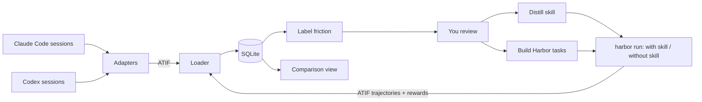

# Spec: from my sessions to a tested skill (working name: Hindsight)

Status: draft 3. The Harbor trial run (phase 0) is done and its results are in section 2.1. No application code written yet.

Changes from draft 1: scope is now one end-to-end path (import sessions → distill a skill → benchmark the skill). Harnesses are Claude Code and Codex only. The benchmark runs on Harbor, and the database follows Harbor's trajectory format (ATIF). The LLM work uses the local `claude -p`. Memory and the proxy are deferred (section 10). The notes app in this repo is replaced.

## 1. What the first version does

1. **Import.** Read every Claude Code and Codex session on this machine into one SQLite database in one format.
2. **Label.** Find the sessions with friction and say what went wrong, in a fixed vocabulary. You review the labels.
3. **Distill.** From a group of similar friction, draft a skill (`SKILL.md`). You edit it.
4. **Benchmark.** Turn the friction sessions into Harbor tasks, run them with and without the skill, several times each, and show whether the skill helped.



One thing to notice in the diagram: Harbor's runs come back as ATIF, and go through the same loader as imported sessions. A benchmark run opens in the same session view as a real session.

## 2. Decisions

| Question | Decision | Why |
|---|---|---|
| Data format | **ATIF v1.7** (the RFC you linked; v1.7 is what Harbor writes), stored as SQLite tables with the same field names | It covers user, agent and system steps, reasoning, tool calls, tool results, per-step tokens and cost, subagents and compaction. Harbor's Claude Code and Codex agents already write it for every run. |
| Benchmark runner | **Harbor**, called as a CLI (`harbor run -c job.yaml`) | It already has what the runner needs: `claude-code` and `codex` agents, a `--skill` option, repeats (`-k`), local Docker by default, subscription auth for both agents, cost and token results, and ATIF output. Building this myself would be most of the project. |
| LLM for labeling, distilling, judging | **Local `claude -p`** with `--json-schema` and `--bare` | Confirmed: the installed CLI has `--json-schema` for structured output. It uses your subscription, with no API key and no new provider. |
| Isolation | **Docker**, through Harbor | Harbor has no bare-host mode, so containers come with the choice. Docker 29.7 is installed here. |
| Harnesses | Claude Code and Codex | Pi and others later, through the same adapter interface. |
| Repo | Replace the notes app here | Keep the project rules: FastAPI, stdlib `sqlite3`, `mypy --strict`, strict TypeScript, `scripts/smoke.sh`, ports 8000 and 5173. |

What I verified and what I did not: the ATIF fields below come from the RFC text. The Harbor facts come from its docs and source at version 0.25.0. I have not installed or run Harbor (it isn't on this machine), so section 8 starts with a short trial run before anything is built on it.

## 3. Import

### 3.1 One path into the database

Each adapter turns a native session file into an ATIF `Trajectory` object. One loader writes ATIF into SQLite. Harbor's output is already ATIF, so it uses the loader directly.

- **Claude Code** (`~/.claude/projects/<project>/<session>.jsonl`). One assistant response is split over several lines that share `message.id`, with usage repeated on each: merge them and count usage once. `isSidechain` records become subagent trajectories. `isCompactSummary` becomes a system step with `extra.context_management = {type: "compaction", boundary: "replace"}`. Bookkeeping records (`mode`, `file-history-snapshot`, `queue-operation`, about 20 more types) are kept raw and produce no steps.
- **Codex** (`~/.codex/sessions/**/*.jsonl`). `response_item` records carry messages, tool calls, tool outputs and reasoning; `event_msg` records carry turn start, turn end and token counts. Join each tool output to its call by `call_id`. Reasoning is encrypted, so `reasoning_content` holds the summary and `extra.reasoning_encrypted` is true.

**The adapters wrap Harbor's converters.** Harbor's `claude_code.py` and `codex.py` each have a function that turns these native logs into ATIF, and the trial showed both work on real local sessions (2.1). The points above are what each wrapper's tests check, and where Harbor's output falls short the wrapper fills in from the raw records. Two cautions: the functions are private (`_convert_events_to_trajectory`), so the Harbor version is pinned and upgrades go through the fixture tests; and on my one Claude Code sample they reported no subagents and no tool errors, which I have not checked against the raw file.

Rules for ingestion:

- Idempotent and incremental: a cursor per file, only appended bytes are read, a re-scan changes nothing.
- Every source line is kept unchanged in `raw_records`, so an adapter fix can re-derive sessions after the harness has deleted the files.
- An unknown record type is stored raw and counted, never dropped and never fatal. The UI shows the count per harness.
- Secrets (key patterns, bearer tokens, `.env` values) are redacted before writing.
- When the watcher first sees a new session it records `git rev-parse HEAD` and whether the tree is dirty. The harnesses mostly don't record this, and section 6 needs it.

### 3.2 Schema

Column names are ATIF's wherever ATIF has the field. Columns marked **+** are additions; on export they go into ATIF's `extra`.

**`trajectories`**

| Column | Notes |
|---|---|
| `trajectory_id` | Primary key. Unique per document. |
| `session_id` | The harness's session id. Shared by a parent and its subagents, so not unique. |
| `parent_trajectory_id` | Set for subagents |
| `schema_version` | `ATIF-v1.7` |
| `agent_name`, `agent_version`, `model_name` | `claude-code` or `codex`; the default model |
| `origin` **+** | `organic` or `benchmark` |
| `project_path`, `git_branch`, `git_commit`, `git_dirty` **+** | |
| `started_at`, `ended_at` **+** | |
| `total_prompt_tokens`, `total_completion_tokens`, `total_cached_tokens`, `total_cost_usd`, `total_steps` | ATIF `final_metrics` |
| `extra` | JSON |

**`steps`**

| Column | Notes |
|---|---|
| `trajectory_id`, `step_id` | `step_id` starts at 1 in each trajectory |
| `timestamp` | |
| `source` | `system`, `user`, `agent` |
| `message` | Text, or a JSON array of content parts when there are images |
| `reasoning_content`, `model_name`, `reasoning_effort` | Agent steps only |
| `prompt_tokens`, `completion_tokens`, `cached_tokens`, `cost_usd` | ATIF `metrics`. `prompt_tokens` includes cached tokens. Claude reports them separately, so the adapter sets `prompt_tokens = input + cache_read + cache_creation` and `cached_tokens = cache_read`. Cache-creation and reasoning token counts go in `extra`. |
| `llm_call_count` | 1 when the step is one model call; null when unknown |
| `stop_reason` **+** | Normalized: `end_turn`, `tool_use`, `max_tokens`, `refusal`, `error`, `interrupted` |
| `turn_index` **+** | One turn = a user message and everything until the next |
| `extra` | JSON |

**`tool_calls`**: one row per call, with its result.

| Column | Notes |
|---|---|
| `trajectory_id`, `step_id`, `tool_call_id` | |
| `function_name`, `arguments` | `arguments` is a JSON object |
| `content` | The matching `observation.results[].content` (joined by `source_call_id`). Large results go to a `blobs` table with a preview here. |
| `subagent_trajectory_id` | From `subagent_trajectory_ref` |
| `is_error`, `error_class` **+** | ATIF has no error field. `error_class` is set by rules: `nonzero_exit`, `not_found`, `permission_denied`, `timeout`, `edit_mismatch`, `user_rejected`, `other`. |
| `tool_kind` **+** | `shell`, `read`, `edit`, `search`, `web`, `mcp`, `subagent`, `other`, so `Bash` and `exec_command` can be queried together |
| `duration_ms` **+** | |

Supporting tables: `raw_records`, `source_files` (the ingest cursor and parser version), `blobs`, and an FTS5 index over messages, reasoning, arguments and results.

Exports are checked with Harbor's `TrajectoryValidator`, in tests and on demand.

### 3.3 UI

- **Sessions**: list with filters (harness, project, model, date, has errors, label) and sort (cost, duration, friction score).
- **Session**: one timeline for both harnesses, with messages, collapsible reasoning, tool calls with arguments, result, error state and duration, tokens and cost per step, and subagents nested.

## 4. Label friction

**Pass 1, rules, every session, free.** Tool error count and rate; the same call failing repeatedly; interruptions and rejected tool calls; a user message right after the agent said it was done; compactions; cost or length far above your norm. The result is a friction score used to rank sessions.

**Pass 2, `claude -p`, on sessions above a threshold or ones you pick.** The input is a condensed trajectory (user messages in full, agent messages, tool calls as one line each, errors in full). The output is validated against a schema:

- `intent`: what you wanted, in one or two sentences
- `task_type`: `feature`, `bugfix`, `refactor`, `setup_integration`, `debugging`, `research`, `review`, `ops`, `other`
- `outcome`: `success`, `partial`, `failed`, `abandoned`, `unclear`, with a reason
- `friction[]`: `type`, `severity` 1–3, the `step_id`s that are the evidence, a short explanation

| Friction type | Meaning |
|---|---|
| `tool_error` | A tool call failed and cost real time |
| `retry_loop` | The agent repeated a failing approach |
| `instruction_ignored` | An explicit user or project instruction was not followed |
| `requirement_missed` | The result did not do what was asked |
| `false_completion` | The agent claimed done or verified when it wasn't |
| `wrong_assumption` | The agent acted on something it didn't check |
| `overreach` | The agent did more than asked, or something destructive |
| `environment` | Setup, auth, ports, dependencies, sandbox |
| `context_loss` | Earlier context was forgotten, often after compaction |
| `user_correction` | You had to steer back |
| `inefficiency` | It worked, with far more steps or tokens than needed |

Labels store the labeler model and prompt version. Each has a review state: `pending`, `confirmed`, `rejected`, `edited`.

**Review screen**: the label beside its evidence steps, keyboard confirm/reject, multi-select. Two actions on a selection: **Distill skill** and **Create benchmark dataset**.

## 5. Distill a skill

1. The app proposes groups of confirmed friction by type and similar explanation. You can also select by hand.
2. `claude -p` gets the evidence for the group: what was asked, what went wrong, what you said, what finally worked. It drafts a skill directory with a `SKILL.md` (a `name`, a `description` that says when to use it, and the instructions).
3. You edit it in the app. Skills are stored in the database with versions and links to the sessions they came from.
4. **Export** writes the skill to a directory. Harbor's `--skill` takes that directory. Installing it into `~/.claude/skills` or `~/.agents/skills` for real use is a separate button, and I'd suggest pressing it only after the benchmark.

## 6. Benchmark the skill on Harbor

### 6.1 A session becomes a Harbor task

```
<dataset>/<task-name>/
  task.toml            name, timeouts, resource limits, [metadata] with the source trajectory_id
  instruction.md       the prompt
  environment/
    Dockerfile         base image + project setup
    repo.tar           snapshot of the repo at the base commit
  tests/
    test.sh            writes /logs/verifier/reward.json
```

- **`instruction.md`** is your first message plus later messages that added requirements. `claude -p` drafts it and you edit it. Messages that only corrected the agent are left out, because they are what the task tests.
- **`environment/`**: `git archive` of the repo at the base commit, copied into the image. Private repos stay on the machine and nothing is cloned in the container. The Dockerfile is generated from what the repo uses (Python and uv, Node, …) and is editable.
- **`tests/test.sh`** runs an optional check command (tests, build) and writes the result as a named metric to `reward.json`. It also saves `git diff` as a Harbor artifact for the judge.
- **Rubric**: drafted from the intent and the friction, as items such as "must do X", "must not do Y", "must follow instruction Z". Stored in the database and in `[metadata]`. You edit it.

Before a task is used, it runs once with no skill to prove that the image builds and the agent can start. A task that fails this is marked broken and not counted.

### 6.2 Two kinds of task

Building a working container for an arbitrary private project at an old commit is the hardest part of the whole design. So there are two kinds:

| Kind | What it is | When to use |
|---|---|---|
| **Replay** | The real repo at the real commit, the real prompt | The commit is known (all sessions imported after install; older ones when you confirm a guessed commit) and the project builds in a container |
| **Reconstructed** | A small standalone project that `claude -p` writes to reproduce the same situation, for example a fresh FastAPI app that needs Stripe webhooks | The repo state is unknown or the project is too heavy. Also suits skills about general procedure, which is most of them. |

Reconstructed tasks have a known weakness: the same model writes the skill and the test. Two guards: the task writer sees the session evidence but never the skill, and where a group has enough sessions, the skill is distilled from some and tested on tasks from the others.

### 6.3 The run

One job config per variant. Both use the same dataset, agent, model and repeat count. They differ only in `agents[].skills`:

```yaml
# with-skill.yaml               (without-skill.yaml omits `skills`)
job_name: stripe-webhooks-with-skill
datasets: [{ path: datasets/stripe-webhooks }]
agents:
  - name: claude-code
    model_name: anthropic/<model>
    skills: [skills/stripe-webhooks]
n_attempts: 3
environment: { type: docker }
```

The backend runs `harbor run -c <file>` as a background job and follows the job directory.

- **Auth** uses your subscriptions. Claude Code needs `CLAUDE_CODE_OAUTH_TOKEN` from a one-time `claude setup-token`. Codex uses `~/.codex/auth.json`, which Harbor copies into the container.
- **Dataset**: the skill's own friction tasks, plus a few unrelated tasks to catch a skill that makes other work worse.
- The same mechanism compares models or harnesses: change `model_name` or `name` and leave `skills` alone. That covers "a new model came out, is it better on my tasks" with no extra design.

### 6.4 Grading

Each trial gets two scores:

1. **Check command** result, from Harbor's `reward.json`.
2. **Rubric score** from a judge. After the trial, the backend runs `claude -p --json-schema` on the host with the instruction, the rubric, the final diff and the condensed trajectory. It returns pass or fail per rubric item, with the evidence.

The judge runs on the host, not in the container, so labeling and judging share one code path and one login. Harbor has its own judge package (RewardKit, which can use Claude Code as the judge inside the verifier). I'd move to it only if you want Harbor's own viewer to show the rubric score.

The judge is not told which variant it is grading. A sample of its verdicts is shown to you to confirm, and the agreement rate is displayed next to the results.

### 6.5 Results

For each trial the backend loads `agent/trajectory.json` through the normal loader with `origin = benchmark`, and stores the reward, rubric results, tokens, cost, duration and any exception from Harbor's trial result.

**Comparison view**

- Per variant: pass rate, mean rubric score, cost, tokens, duration, tool errors, and whether the skill was invoked at all (from the trajectory).
- Per task: both variants side by side across repeats, each cell linking to that run's trajectory and diff.
- The spread across repeats is shown beside each mean. If the difference is inside the spread, the view says "no clear difference".

"Was the skill invoked" matters. A skill that never triggers shows no effect, and the fix is its description, not its content.

## 7. Technical shape

- **Backend**: `adapters/` (Claude Code, Codex), `atif/` (models, loader, export), `store/` (schema, migrations, queries), `labeling/`, `skills/`, `bench/` (task builder, Harbor job runner, judge), `llm/` (the `claude -p` wrapper), `api/`.
- **Harbor** is installed as a tool (`uv tool install harbor`, needs Python 3.12+) and called by subprocess. The backend imports only its ATIF models and validator.
- **`claude -p` wrapper**: one typed function, `run_structured(prompt, schema) -> validated object`. It always passes `--bare` so your hooks, skills and `CLAUDE.md` don't leak into labeling or judging. Its own sessions are written to a separate directory that the importer ignores, so the tool doesn't ingest its own work.
- **Database**: one file, `~/.hindsight/hindsight.db`, WAL mode, numbered SQL migrations.
- **Background work** (scan, label, distill, runs, judging): a `jobs` table and one worker thread. Progress is visible in the UI.
- **Tests**: small redacted fixture sessions per adapter with expected ATIF; validator on every export; API tests per endpoint.

## 8. Phases

| Phase | Scope | Done when |
|---|---|---|
| **0. Harbor trial** | **Done**, see 2.1. Claude Code only. | Passed: both runs finished in Docker, the skill changed the result, and the outputs are where section 6 expects them. |
| **1. Import** | Schema, two adapters, loader, incremental scan, redaction, commit capture, session list and session view, ATIF export | Every Claude Code and Codex session on this machine loads with no parse failures; exports pass Harbor's validator; token totals for five sampled sessions match the harness's own numbers; a re-scan changes nothing |
| **2. Label** | Rule pass, `claude -p` pass, review screen | On 30 sessions you label by hand, the outcome label agrees on at least 80%, with disagreements listed |
| **3. Distill** | Grouping, skill draft, editor, export | A skill drafted from a real friction group is one you'd keep after editing |
| **4. Benchmark** | Base image with Claude Code preinstalled, task builder (reconstructed first, then replay), Harbor runner for `claude-code`, host judge, result import, comparison view | One skill, its tasks, with and without, three repeats each, gives a comparison where every number opens the run behind it |

Phase 4 starts with reconstructed tasks because they don't depend on recovering old repo state. Replay tasks follow for sessions imported after phase 1 is installed, which have a recorded commit.

## 9. Risks

- **Dependence on Harbor's private converter functions.** They work today (2.1) but can change in any release. The version is pinned and the fixture tests guard upgrades.
- **Trial setup time.** About 3 minutes per trial until the preinstalled base image exists (2.1).
- **Containerizing real projects.** Many replay tasks will need a hand-edited Dockerfile. Reconstructed tasks are the way around it, with the weakness in 6.2.
- **Small numbers.** A handful of tasks with three repeats can show a large effect and not a small one. The view says so and doesn't name a winner on noise.
- **The judge is Claude.** For with/without-skill on one model this is fine. For Claude-versus-Codex comparisons it may favor its own style; use the check command as the main score there, or add a second judge.
- **Subscription limits.** Tasks × variants × repeats uses your quota. The app shows the trial count before a run starts and runs at low concurrency by default.
- **Replay safety.** A session that deployed, sent messages or touched production must not do it again from a container. Tasks built from sessions with such tool calls are flagged and held until you review them. Containers get no credentials except the agent's own login.
- **Format drift.** Claude Code writes about 25 record types and both formats change without notice. Raw records are kept, adapters are versioned, and unknown records are counted.

## 10. Deferred

- **Memory across harnesses.** Search over the same database, exposed to harnesses by an MCP server and CLI, plus distilled preferences and procedures. The schema needs no changes; it adds an embeddings table. A distilled skill is already the first form of this: it is a procedure learned from your sessions and installed into both harnesses.
- **Local proxy and routing.** Logs API traffic, then routes by rules, then by benchmark results per `task_type`. The model comparison in 6.3 produces the data it would route on.
- **More harnesses** (Pi, OpenCode, Cursor) through the adapter interface.

## 11. Settled

1. Harbor trial first: done (2.1).
2. Task order: reconstructed tasks first, replay tasks second (your call was "whatever is reasonable"; this avoids the Dockerfile work for old repos).
3. Benchmark agent for the MVP: Claude Code only.

No open questions block phase 1.
